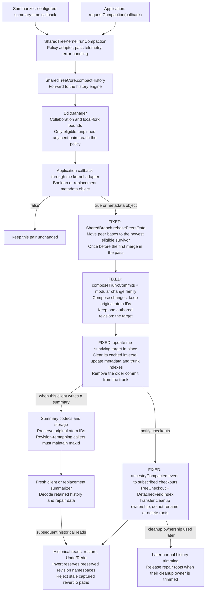

# SharedTree history compaction: developer guide

This is the detailed guide to application-guided history compaction in SharedTree.
It explains what compaction is, which history it changes, the API contract, the design that is implemented,
how revisions are preserved, what can go wrong with persisted data, what telemetry exists,
how it is tested, and what is still open.

> Status: **experimental (`@alpha`)**.
> The API shape is not final.
> Compaction (manual and summary-time) and preserved revisions (pins, opt-in) are implemented and tested.
> Stable repair identities, repair-data cleanup ownership, cached-inverse invalidation, and maximum-ID tracking are implemented and covered by regressions.
> Other integrity risks and proposed telemetry remain open ([Part IV](#part-iv-persisted-format-and-data-integrity)).
> The short, app-facing guide is [APP_GUIDE.md](./APP_GUIDE.md).

## How to read this guide

| If you want to know… | Read |
| --- | --- |
| What compaction is, and which history and which clients it affects | [Part I: Concepts](#part-i-concepts) |
| The exact API and its guarantees | [Part II: API specification](#part-ii-api-specification) |
| How it is built, and why | [Part III: Design and implementation](#part-iii-design-and-implementation) |
| Subsystem block diagram and what the correctness fixes change | [§12.1](#121-subsystem-flow-and-correctness-changes) |
| How pins (preserved revisions) work | [§11](#11-preserved-revisions-design) |
| What can corrupt persisted data, and the fixes | [Part IV: Persisted format and data integrity](#part-iv-persisted-format-and-data-integrity) |
| Each discovered bug, its cause, fix, and named regression | [§17.9: Bug-to-regression index](#179-bug-to-regression-index) |
| What to monitor | [Part V: Telemetry](#part-v-telemetry) |
| How it is tested and how to run things | [Part VI: Testing and running](#part-vi-testing-and-running) |
| What is undecided | [Part VII: Open questions](#part-vii-open-questions) |

## Contents

- [Part I: Concepts](#part-i-concepts)
  1. [What problem this solves](#1-what-problem-this-solves)
  2. [Clients: local, interactive, and summarizer](#2-clients-local-interactive-and-summarizer)
  3. [History model: trunk, MSN, and trimming vs. compaction](#3-history-model-trunk-msn-and-trimming-vs-compaction)
  4. [Which history gets compacted](#4-which-history-gets-compacted)
  5. [Commits needed for correctness vs. commits kept only for history](#5-commits-needed-for-correctness-vs-commits-kept-only-for-history)
- [Part II: API specification](#part-ii-api-specification)
  6. [Public types](#6-public-types)
  7. [The policy contract](#7-the-policy-contract)
  8. [Where and when compaction runs](#8-where-and-when-compaction-runs)
  9. [Preserved revisions API](#9-preserved-revisions-api)
- [Part III: Design and implementation](#part-iii-design-and-implementation)
  10. [Design decisions](#10-design-decisions)
  11. [Preserved revisions design](#11-preserved-revisions-design)
  12. [Architecture: where the code lives](#12-architecture-where-the-code-lives)
  13. [The algorithm](#13-the-algorithm)
  14. [Metadata before and after compaction](#14-metadata-before-and-after-compaction)
  15. [How the policy reaches the summarizer: approaches considered](#15-how-the-policy-reaches-the-summarizer-approaches-considered)
- [Part IV: Persisted format and data integrity](#part-iv-persisted-format-and-data-integrity)
  16. [What changes in persisted data](#16-what-changes-in-persisted-data)
  17. [Data-integrity risks and fixes](#17-data-integrity-risks-and-fixes)
- [Part V: Telemetry](#part-v-telemetry)
  18. [Implemented telemetry](#18-implemented-telemetry)
  19. [Proposed integrity telemetry](#19-proposed-integrity-telemetry)
  20. [How to monitor a rollout](#20-how-to-monitor-a-rollout)
- [Part VI: Testing and running](#part-vi-testing-and-running)
  21. [Test map](#21-test-map)
  22. [What the tests showed](#22-what-the-tests-showed)
  23. [How to run things](#23-how-to-run-things)
- [Part VII: Open questions](#part-vii-open-questions)
  24. [Open questions and decisions to make](#24-open-questions-and-decisions-to-make)
  25. [API review: findings and options](#25-api-review-findings-and-options)
- [Glossary](#glossary)

---

## Part I: Concepts

### 1. What problem this solves

SharedTree can keep its edit history beyond what collaboration needs.
This is turned on with the `retainHistory` option
(`false` keeps no extra history; `true` keeps all of it; a number N tries to keep the newest N commits, plus whatever correctness still needs, see [§3](#3-history-model-trunk-msn-and-trimming-vs-compaction)).
Applications use retained history for features like version history, activity feeds, timelines, and "restore to a point in time".

Kept history grows forever, one commit per edit.
Most applications do not need every intermediate state.
They need *some* points in time, for example "the end of each editing session" or "every save".

**History compaction** lets the application say which neighbouring commits may be merged.
Two merged commits become one commit with the same overall effect.
The state *between* them is lost, but every state the application cares about is kept.

SharedTree does not decide what matters.
The application decides, through a callback, based on metadata that it attached to its own commits
(`runTransaction(..., { customMetadata })`).

### 2. Clients: local, interactive, and summarizer

There is **one** compaction algorithm.
What differs between clients is whose in-memory history it changes, and whether that history is written to storage.

#### 2.1 Interactive client

An **interactive client** is an instance of the application that a user is working in.
It loads the document, shows it, and sends edits (ops).
Every interactive client keeps its own copy of the SharedTree in memory, including its own copy of the edit history.

Things that are only in one client's memory and never shared:

- unsent or unacknowledged local edits,
- local branches (forks) and their base commits,
- undo/redo stacks (revertibles) and the repair data they need,
- the result of any compaction that client ran.

#### 2.2 Summarizer client

Fluid documents are not stored as an endless list of ops.
Periodically, one client writes a **summary**: a snapshot of the document that new clients load from.

The **summarizer client** is a separate, hidden client that the container runtime starts in the background
(it is elected; normally only one exists at a time).
It has no UI, no user, no undo stack, and no local branches.
It loads the document like any other client, processes ops, and writes a summary when the runtime asks it to.

Key consequence:
**the history inside a summary is whatever is in the summarizer's memory when it summarizes.**
It is not the history of whichever interactive client happens to be editing.

A summarizer can be replaced at any time (for example after a reconnect or a new election).
The new one starts from the last summary plus the ops after it, with none of the previous summarizer's in-memory state.

#### 2.3 "Local" is not a role

**Local** means "on this client instance".
An interactive client has local history, and so does the summarizer.
`requestCompaction` is always local: it changes only the instance it is called on.

#### 2.4 How each client is affected

| | Interactive client | Summarizer client |
| --- | --- | --- |
| Has a user, UI, undo stack | Yes | No |
| Has local branches | Often | No |
| Where its history lives | In memory only; lost on close | In memory, then written to the summary |
| Who loads its history later | Nobody | Every client that loads from that summary |
| Runs the configured policy | Only for the attach summary of a tree created detached (a no-op: nothing is old enough) | Before every summary that includes the tree |
| Benefit of compaction | Lower memory in a long session | Smaller summaries, faster loads, lower memory for **all** future clients |
| Risk of compaction | Breaking undo, revert, or local branches ([§17](#17-data-integrity-risks-and-fixes)) | Low for itself, but **its mistakes are persisted** and inherited by every loading client |
| Sends pin rejections | No (logs only) | Yes ([§11.4](#114-rule-4-the-summarizer-rejects-pins-it-cannot-keep)) |

**Why local compaction on interactive clients matters little:**
an interactive client's history disappears when the user closes the app, it is not shared,
and its old commits are often still used by undo stacks or local branches.
The summarizer's history is written to storage and loaded by every future client; that is where compaction pays off.

### 3. History model: trunk, MSN, and trimming vs. compaction

- The **trunk** is the sequenced (ordered by the service) list of commits on the main branch.
- The **trunk base** is the oldest commit still held; everything before it was trimmed.
- The **minimum sequence number (MSN)** is the oldest sequence number that some client may still be basing new edits on.
- The **collaboration window** is the part of the trunk newer than the MSN.
  Commits in the window are still needed to rebase incoming edits and **must not be changed**.
- Commits older than the MSN are outside the window.
  What happens to them depends on `retainHistory`:

  | `retainHistory` | Commits outside the window |
  | --- | --- |
  | `false` or `0` (default) | No history is retained. They are **trimmed** (dropped) once nothing else needs them. |
  | `true` | **All** available commits are kept. |
  | A number N | Best effort to keep the newest N main-branch commits (each sequenced commit counts, including commits in one batch). Older ones are trimmed. |

  N is a minimum, not a hard cap.
  In every mode, SharedTree keeps any extra commits needed for correctness:
  the collaboration window, and the bases of existing local branches.
  The count can also exceed N temporarily while the container is detached (trimming waits for a summary)
  and right after loading a summary (trimming waits until the service reports the collaboration window).
  See the `SharedTreeOptions.retainHistory` JSDoc in `src/shared-tree/sharedTree.ts`.

  Commits kept **only** because of `retainHistory` are the only ones compaction may touch.

| | Trimming | Compaction |
| --- | --- | --- |
| What happens | Old commits are dropped from the start of history | Neighbouring kept commits are merged into one |
| What survives | Only what `retainHistory` keeps | The points in time the application chose to keep |
| Who decides | SharedTree, from `retainHistory` and the MSN | The application, through a callback |
| When | Every time the MSN moves, and before each summary | Before each summary (configured policy), or on `requestCompaction` |
| Event | Emits `ancestryTrimmed` (frees repair data) | Emits `ancestryCompacted` to transfer cleanup ownership; does not free repair data |
| Ops | None | None |

### 4. Which history gets compacted

**Short answer: only the `main` branch's trunk, and only on the client instance that runs compaction.**
The current API does not expose compaction on a fork's view and does not compact the fork's own edits.
This is an API and implementation boundary, not a claim that fork compaction is fundamentally impossible.

#### 4.1 The API is on the tree, not on a view or branch

`historyCompaction` exists only on `ITreeAlpha` (the tree-level object, `asAlpha(sharedTree)`).
It is **not** on `TreeView`, `TreeViewAlpha`, `TreeBranch`, or the checkout.
An early prototype put it on `TreeViewAlpha`; it was moved because a view is one schema-typed window onto one branch,
while retention, trimming, and summaries belong to the whole DDS.

Calling `asAlpha(sharedTree).historyCompaction.requestCompaction(...)` while holding a fork's view still targets the DDS's main shared branch, not that fork.
The implementation explicitly selects `main`; the policy cannot select another branch.
A fork-level API would need a separate contract for how compaction interacts with merging, rebasing, and undo.

#### 4.2 What each kind of history experiences

```text
main trunk (this client):   base ── c1 ── c2 ── c3 ── c4 ── c5 │ c6 ── c7     (│ = MSN)
                                                  ▲
local fork F:                                     └── f1 ── f2              (F is based on c3)

eligible for compaction:    base ── c1 ── c2 ── c3
                                                 ▲ capped at F's base (older than the MSN bound)
```

| History | Compacted? | Why |
| --- | --- | --- |
| Main trunk, below the MSN and below every open fork's base | **Yes** (when the policy approves) | It is kept only for history. |
| Main trunk, in the collaboration window | No | Peers still rebase over it. |
| Main trunk, at or above the oldest open local fork's base | No | The fork depends on that commit as its base; composing it away would detach the fork. |
| A local fork's own commits (`f1`, `f2`) | **Never** | They are not on the trunk; compaction only walks the trunk. |
| Other shared branches (`createSharedBranch`) | **Never** | Only `main` is compacted. Pins are also disabled with shared branches. |
| Unsequenced local edits | Never | They are not on the trunk yet. |
| Another client's history | Never | Compaction sends no op. Each client's history changes only if it compacts. |
| The stored history in the summary | Only when the **summarizer** compacts | The summary holds the summarizer's history. |

In code: `EditManager` tracks every local fork in `trunkBranches` (a B-tree keyed by the sequence ID of each fork's base),
through `registerBranch` / `trackBranch`.
`getUpperTrimmingBoundForLocalForks` returns the sequence ID just before the oldest fork base,
or the trunk's newest key if there are no forks.
Compaction's upper bound is the smaller of this and the MSN bound ([§13.1](#131-which-commits-are-eligible)).
Trimming uses the same bound.

**Consequence for apps:** on an interactive client, an open fork (for example a preview branch) silently reduces what a manual `requestCompaction` can do.
A summarizer normally has no application-created local forks, so the fork-base bound normally adds no restriction.
If application code creates a fork on that client, the same bound applies; being a summarizer does not bypass it.

#### 4.3 What changes when the client is the summarizer

The target and eligibility rules do not change: compaction still rewrites only that client's `main` trunk.
The difference is that the summarizer runs the configured policy before writing a summary, so its compacted history is persisted.
Clients loading that summary receive the compacted history.
Already-connected clients do not have their in-memory histories rewritten by the summarizer's compaction, because compaction sends no op.

### 5. Commits needed for correctness vs. commits kept only for history

SharedTree keeps a commit for one of two reasons:

- **Needed for correctness:** something still depends on it.
  These are **never** offered to the policy as `current` (the commit that would be removed).
- **Kept only for history:** `retainHistory` is the only reason it exists.
  These are the only commits the policy can merge away.

| Commit | Category | Why it must stay |
| --- | --- | --- |
| Unsequenced local commit | Correctness | Not yet ordered by the service. |
| Commit in the collaboration window (newer than the MSN) | Correctness | Incoming edits from peers may be based on it and must be rebased over it. |
| The newest eligible commit | Correctness | Commits after it have it as their parent and depend on its output state. It can absorb older commits but is never removed. |
| A commit an open local fork is based on, and every later one | Correctness | The fork's base must exist. |
| The trunk base | Structural | It is the root of the retained chain. |
| A preserved (pinned) commit | App guarantee | The app asked for this point in time to stay restorable ([§9](#9-preserved-revisions-api)). Never `current` or `target`. |
| Any other commit older than the MSN | **History only** | Offered to the policy, oldest first. |

A commit moves from "correctness" to "history only" when the MSN passes it (and no fork holds it).
Compaction does not run at that moment; it runs at the next summary or `requestCompaction` ([§8](#8-where-and-when-compaction-runs)).

**The policy cannot affect correctness.**
It only chooses which history-only points in time to keep.
The `CanCompactCommit` JSDoc lists the same rules.

> The eligibility boundary protects collaboration and existing fork bases; it is not the whole correctness contract.
> Reconstruction of every retained state also needs stable repair identities, valid inverse changes, and repair data kept until its surviving owner is trimmed.
> These are Fluid's responsibilities, not application policy decisions.
> The reproduced defects and their fixes are in [§17.1](#171-high-composition-renumbers-detach-ids-so-repair-data-no-longer-matches) and [§17.2](#172-high-repair-data-for-composed-away-revisions-is-never-freed).

---

## Part II: API specification

### 6. Public types

All types are `@alpha`, in [`src/simple-tree/api/historyCompaction.ts`](../../src/simple-tree/api/historyCompaction.ts).

```typescript
interface ITreeAlpha {
	readonly historyCompaction: TreeHistoryCompaction;
}

interface TreeHistoryCompaction {
	requestCompaction(canCompactCommit: CanCompactCommit): number; // number of commits removed
	setRevisionPreserved(revision: CommitRevision, preserved: boolean): void; // needs enableRevisionPreservation
	isRevisionPreserved(revision: CommitRevision): boolean;
	readonly events: Listenable<TreeHistoryCompactionEvents>;
}

interface TreeHistoryCompactionEvents {
	revisionPreservationRejected(revision: CommitRevision): void; // the summarizer could not keep a pin
}

interface SharedTreeOptions {
	readonly historyCompaction?: SummaryHistoryCompactionOptions;
}

interface SummaryHistoryCompactionOptions {
	readonly canCompactCommit?: CanCompactCommit; // runs before each summary
	readonly enableRevisionPreservation?: boolean; // turns on pins (new op and summary format)
}

type CanCompactCommit = (candidate: {
	readonly current: TreeBranchCommitMetadata; // older; removed if accepted
	readonly target: TreeBranchCommitMetadata; // newer; absorbs `current` and keeps its revision
}) => boolean | JsonCompatibleReadOnlyObject;
```

Minimum configuration for the summarizer to compact stored history:

```typescript
const SharedTree = configuredSharedTree({
	retainHistory: true, // or a number, see §8.4
	minVersionForCollab: FluidClientVersion.v2_117, // persists the custom metadata the policy reads
	historyCompaction: {
		canCompactCommit: ({ current, target }) =>
			current.custom?.session !== undefined && current.custom.session === target.custom?.session,
	},
});
```

### 7. The policy contract

#### 7.1 Inputs

`current` and `target` are the same `TreeBranchCommitMetadata` type that the history APIs return
(`revision`, `custom`, `customTree`, `getParent()`, `revertTo`), with three differences:

- `revertTo` is always `undefined`. The policy must not edit the tree while its history is being rewritten.
- `getParent()` walks the main trunk, not a view's branch.
  It stops at the trunk base, so it only reaches older commits that are not yet trimmed.
  Commits already combined in this pass are not reachable.
- The objects are valid only during the call. Once the pass continues, `current` may no longer exist.

`current` is the older commit and is removed if combined; `target` is the next commit, which absorbs it.
(These were renamed from `before` / `after`, which read like times rather than roles.)

#### 7.2 Return value

| Policy returns | Effect | Combined commit's metadata |
| --- | --- | --- |
| `false` | Both points in time are kept. | Unchanged. |
| `true` | Combined. | Default merge: `customTree` is `{ metadata: undefined, children: [current, target] }` (or the one that exists); `custom` is flattened, newest wins on conflicting keys. |
| A JSON object | Combined. | The object **replaces** both commits' metadata: `custom` is the object, `customTree` is `{ metadata: object, children: [] }`. The next question about this commit sees the object as `current.custom`. |
| Anything else (for example `null`) | `UsageError` | Handled as a policy failure ([§7.4](#74-errors)). |

SharedTree checks only the top level of a returned object.
It does not deep-validate JSON compatibility or copy the object; a non-JSON value inside fails when the summary is encoded.
The app must not mutate the object after returning it.

#### 7.3 Guarantees

- Only history kept because of `retainHistory` is considered. With `retainHistory: false` (or `0`), `requestCompaction` returns `0`.
- The policy is never asked about a commit needed for correctness ([§5](#5-commits-needed-for-correctness-vs-commits-kept-only-for-history)).
- Pairs are offered oldest first.
  If a pair is accepted, the next pair is *(merged commit, next commit)*, so a run of accepted pairs merges many commits into one.
- The merged commit keeps the **newer** commit's revision. A preserved revision is therefore never renamed.
- A preserved commit is never combined with an older or newer commit, on any client, including the summarizer.
  Pairs containing it are skipped **before** the policy is called.
- Compaction changes only the calling client's in-memory history.
  It sends no op. It reaches storage only if this client writes a summary.
- It does not change the current tree state, only the history leading to it.
- **Declined pairs are asked again on every pass.** The engine keeps no memory of earlier answers.
  The policy must therefore be deterministic and depend only on `current` and `target`
  (not on the current time, call counts, or other outside state).
  Otherwise an earlier "no" can become a "yes", and stored history depends on when summaries ran.
- The policy must be fast. It runs on the summarize path, once per eligible pair, every pass.

#### 7.4 Errors

| Where | What happens |
| --- | --- |
| Summary-time policy throws or returns an invalid value | Decided: the wrapper records the error and answers "do not combine" for every remaining pair. Merges already made are kept. `HistoryCompaction` is logged with `status: "failure"`, `failureSource: "policy"`. The summary is still written. The tree is **not** broken. |
| Manual `requestCompaction` policy throws | Open ([§24.2](#242-manual-requestcompaction-when-the-policy-throws)): the error propagates; merges already made stay; the caller gets no count; telemetry reports partial progress. The error passes through the kernel's breaker, so **the tree is marked broken**. |
| `setRevisionPreserved` usage errors | `UsageError`, tree not broken (`@throwIfBroken`, checks before any state change). |

#### 7.5 Examples

Keep one point in time per editing session:

```typescript
const tree = asAlpha(sharedTree); // created with retainHistory: true

view.runTransaction(() => { /* edit */ }, { customMetadata: { session: sessionId } });

const removedCount = tree.historyCompaction.requestCompaction(
	({ current, target }) =>
		current.custom?.session !== undefined && current.custom.session === target.custom?.session,
);
```

Bound a run by when it **started** (each edit is authored with `customMetadata: { time }`).
This needs replacement metadata, because with `true` the start time is hidden by newest-wins:

```typescript
tree.historyCompaction.requestCompaction(({ current, target }) => {
	const start = current.custom?.start ?? current.custom?.time; // `start` exists once combined
	const time = target.custom?.time;
	if (typeof start !== "number" || typeof time !== "number") return false;
	return time - start < 5 * 60_000 ? { start, time } : false;
});
```

Keep a checkpoint chosen when the commit is made, without pins:

```typescript
view.runTransaction(edit, { customMetadata: { session, keep: true } });
const policy: CanCompactCommit = (pair) => pair.current.custom?.keep !== true && sameSession(pair);
```

Note: `keep: true` only stops that commit from being `current`; it can still absorb older commits as `target`.
Use a pin ([§9](#9-preserved-revisions-api)) to protect a commit in both directions.

### 8. Where and when compaction runs

A commit becoming history-only does not trigger compaction by itself.
Compaction runs only at these call sites:

| Trigger | Call site | Whose history | Status |
| --- | --- | --- | --- |
| Summarization (configured policy) | `SharedTreeKernel.summarizeCore` → `compactHistoryForSummary` → `runCompaction` | The client writing the summary (normally the summarizer); this is **stored** history | Implemented |
| App call, any number of times | `historyCompaction.requestCompaction` → `runCompaction` | The calling client's memory | Implemented |
| MSN advance | Would hook `EditManager.advanceMinimumSequenceNumber`, next to `trimHistory` | Every client's memory, continuously | Not implemented ([§24.5](#245-smaller-open-items)) |

#### 8.1 The configured policy (summary time)

Every client uses the same factory, but the policy runs only when **that client enters the tree's `summarizeCore` hook**:

1. The runtime asks the tree for its summary (`summarizeCore`).
2. The kernel calls `runCompaction` with the configured policy, using the same rules as a manual call.
3. The kernel writes the summary as usual. `getSummaryData` trims first, and the summary encodes the compacted trunk.

Things to know:

- **Compaction may wait for the next edit.**
  If no ops for this tree arrived since the last summary, the runtime reuses the previous summary handle
  (`!fullTree && !hasChanged()` in `summarizerNode.ts`) and does not call `summarizeCore`.
  Commits that became eligible only because the MSN moved wait for the next edit. This delays, never loses, data.
- **A summary can run more than one pass.**
  `SharedObject.processGCDataCore` calls `summarizeCore` to collect handle references, and the real summary calls it again.
  The real-container test sees two `"summary"` passes: the first removes 36 commits, the second removes 0.
- **A freshly loaded summarizer cannot compact until it processes an op.**
  The MSN is not stored in the summary ([§22.3](#223-a-freshly-loaded-client-cannot-compact-yet)).
- **The summarizer's own in-memory history is compacted too.**
  Absence of application readers does not establish historical-read safety: a fresh client inherits its compacted history ([§22.5](#225-controlled-lifecycle-reproduction)).

#### 8.2 Manual `requestCompaction`

`requestCompaction(policy)` runs an immediate pass on the calling client only.
On an interactive client it does **not** change stored history (verified end to end, [§22.1](#221-findings)).
It does reduce that client's memory, but it exposes the undo/revert and repair-data risks of [§17](#17-data-integrity-risks-and-fixes),
and a throwing policy breaks the tree ([§7.4](#74-errors)).
Prefer the configured option for storage; use manual calls only for deliberate maintenance, with a policy that cannot throw.

#### 8.3 Different app versions

Clients running different app versions may have different policies.
The stored history reflects whichever version the summarizer runs.
This is acceptable because compaction does not need to match between clients.

#### 8.4 Retention limit and compaction together

```typescript
const SharedTree = configuredSharedTree({
	retainHistory: 1000, // best effort: keep the newest 1000 commits, plus any more that correctness needs
	minVersionForCollab: FluidClientVersion.v2_117,
	historyCompaction: { canCompactCommit: sameSession },
});
```

- **The limit counts commits that exist now.** A compacted commit counts as **one**, so the same N reaches further back.
- **Compaction only sees what trimming kept.** It never brings back trimmed commits.
- **Trimming runs first and more often** (every MSN change), compaction only at the next summary.
  New raw commits fill the limit and can push older compacted points out before they are compacted.
  The limit holds about *N minus the commits made between two compactions* compacted points, plus the newer raw commits.
- **If more than N commits arrive between two summaries, compaction gains nothing for retention.**
  Pick N well above the expected commits per summary interval.

Measured with N = 10, 8 rounds of 5 commits each (one group per round), compacting after each round:

| | Commits kept | Groups covered |
| --- | --- | --- |
| Without compaction | 10 | 2 (groups 6–7) |
| With compaction | 6 | 4 (groups 4–7) |

A possible improvement, "compact before trimming", is listed in [§24.5](#245-smaller-open-items).

### 9. Preserved revisions API

A **pin** keeps one point in time restorable even if the policy would merge it away
(a named version, a published version, a point before a risky bulk edit).
"Preserved" means: **the document state right after revision R stays restorable, under the same revision.**

```typescript
const factory = configuredSharedTree({
	retainHistory: 1000,
	historyCompaction: { canCompactCommit: sameSession, enableRevisionPreservation: true },
}).getFactory();

const compaction = asAlpha(tree).historyCompaction;
compaction.setRevisionPreserved(revision, true); // pin; sent to every client
compaction.isRevisionPreserved(revision); // true once this client applied the pin (optimistic for the caller)
compaction.setRevisionPreserved(revision, false); // unpin
compaction.events.on("revisionPreservationRejected", (revision) => { /* the checkpoint is gone */ });
```

`setRevisionPreserved` throws a `UsageError` when:

- `enableRevisionPreservation` is off, or shared branches or detached-root editing is enabled;
- pinning a revision this client does not know;
- pinning a revision no longer in the main history (trimmed or compacted).

Unpinning an unknown revision does nothing. These errors do not break the tree.
`setRevisionPreserved` returns `void`: the real outcome is known only when the summarizer processes the op.

Contract summary:

| Question | Answer |
| --- | --- |
| Does a pin stop compaction? | Yes, in both directions, on every client. |
| Does a pin stop trimming by `retainHistory`? | **No.** A pinned commit outside the limit is trimmed and its pin dropped ([§11.2](#112-rule-2-pins-do-not-stop-trimming)). |
| Is a pin shared? | Yes, through an op, and stored in the summary. |
| Is `isRevisionPreserved() === true` a guarantee? | No. It is optimistic until the summarizer processes the pin. If the summarizer already lost R, it sends a rejection and `revisionPreservationRejected` fires ([§11.4](#114-rule-4-the-summarizer-rejects-pins-it-cannot-keep)). |
| Can I tell trimming from compaction in a rejection? | No. |
| Should I auto-retry after a rejection? | No: re-pinning is rejected again. |

---

## Part III: Design and implementation

### 10. Design decisions

| Decision | Reason | What the code does |
| --- | --- | --- |
| **Compaction belongs to the SharedTree, not a view or branch.** | Retention, trimming, and summaries belong to the whole DDS. | `ITreeAlpha.historyCompaction`; removed from `TreeViewAlpha` / `TreeCheckout` ([§4](#4-which-history-gets-compacted)). |
| **The application decides, using its own commit metadata.** | Apps already attach persisted custom metadata. SharedTree should not interpret it. | `CanCompactCommit` receives `current` and `target`. |
| **Decide pairwise, oldest first.** | Comparing one commit with the next is the simplest rule that expresses "same session" or "same save". | An accepted pair becomes the next `current`. |
| **Synchronous, returns a number.** | Nothing waits on I/O; the only output is the removed count. | `requestCompaction(cb): number`. `CompactionResult` was removed. |
| **The pair is `current` / `target`.** | `before` / `after` read like times, not roles. | `CanCompactCommit({ current, target })`. |
| **Reuse `TreeBranchCommitMetadata`; no `CompactionCandidate`.** | One type serves history browsing and compaction. | The kernel wraps commits in `LazyTreeBranchCommitMetadata` with `revertTo` disabled. |
| **The JSDoc explains the API with a timeline.** | App authors reason about "when does a commit become history only". | The `A ← B ← C ← D ← E` example ([§13.2](#132-walking-pairs)); a test pins down the same sequence. |
| **The policy may return the combined metadata (option b, prototype).** | Only the app knows what its next decision needs; the default merge hides the oldest values and grows. | `boolean \| JsonCompatibleReadOnlyObject` ([§25](#25-api-review-findings-and-options)). |
| **One callback decides and shapes metadata.** | A separate `ComposeCommitMetadata` (option c) needed two functions to read the pair the same way. | `CanCompactCommit` is the only callback. |
| **Configured on the factory, not registered at runtime.** | The summarizer is built from the same container code and registry, so a factory option reaches it with no extra app code. | `SharedTreeOptions.historyCompaction.canCompactCommit`, run in `summarizeCore` ([§15](#15-how-the-policy-reaches-the-summarizer-approaches-considered)). |
| **The summarizer is what matters for storage.** | Only its history is stored; interactive clients gain little. | The option runs wherever the summary is written. |
| **A faulty policy must not block summaries or break the tree.** | Summaries keep the document loadable. | Summary-time errors are caught, logged, and end compaction. |
| **Never touch what collaboration or local state needs.** | Peers need the window; forks need their base. | Eligibility capped by the MSN and the oldest local fork base. |
| **Retention limit and compaction compose.** | Apps want bounded *and* compact history. | A compacted commit counts as one toward `retainHistory: N`. |
| **Pins are shared through an op and stored in the summary.** | A pin only protects stored history if the summarizer knows it; authored metadata cannot be edited later. | `preserveRevision` op and `preservedTrunkIndices` summary field. |
| **Pins are opt-in, under a separate format.** | Older clients cannot read the new op and summary format. | `enableRevisionPreservation` selects `history-compaction\|v0.1`. |
| **Pins are optimistic; the summarizer rejects what it cannot keep.** | The caller cannot know synchronously whether the summarizer still has R. | Rejection op with `rejected: true` and the `revisionPreservationRejected` event. |

### 11. Preserved revisions design

#### 11.1 Rule 1: pins block compaction in both directions

```text
history:   A1 ─ A2 ─ [A3] ─ A4 ─ A5      ([A3] is preserved; the policy says "yes" to every pair)

(A1, A2)   → combine            → A2'
(A2', A3)  → skipped            →       A3 cannot absorb older commits
(A3, A4)   → skipped            →       A3 cannot merge into newer commits
(A4, A5)   → combine            → A5'

result:    A2' ─ [A3] ─ A5'              A3 keeps its original change data and metadata
```

`EditManager.compactHistory` skips a pair if `preservedRevisions` contains either revision, before calling the policy.
Preservation is a guarantee, not a hint. One pinned middle commit blocks two pairs (`preservedPairCount: 2`).
Unpinning makes the surrounding pairs eligible again on the next pass.

#### 11.2 Rule 2: pins do not stop trimming

Option **P1** is implemented: a pinned commit counts toward `retainHistory: N` like any other.
When it falls outside the limit it is trimmed, and `EditManager.trimHistory` removes its pin.

- `retainHistory` stays the one setting that bounds memory and storage.
- Apps that need pins to live forever use `retainHistory: true`.
- Option **P2** (pins hold trimming back) can be added later as an opt-in.

Not yet done: telling the app when its own client trimmed a pin. A new pin on a revision the summarizer already trimmed is rejected (Rule 4).

**How a trimmed pin leaves the persisted format.**
No op or cleanup step is needed: the next summary from the summarizer simply no longer contains it.

1. The summarizer trims the commit: `EditManager.trimHistory` deletes each trimmed revision from `preservedRevisions`.
2. `EditManager.getSummaryData` writes only pins whose revision is in the summarized main trunk.
3. The format cannot hold an orphaned pin: `preservedTrunkIndices` are positions in that summary's own `trunk` array ([§11.5](#115-how-pins-are-stored)).
4. A summary is a full snapshot, so clients loading the new summary no longer see the pin.

Caveats:

- Only trimming on the **summarizer** changes storage. An interactive client that trims changes only its own memory.
- It can be delayed: with no new ops for the tree, the runtime reuses the previous summary handle ([§8.1](#81-the-configured-policy-summary-time)),
  and a freshly loaded client does not trim until it learns the MSN ([§22.3](#223-a-freshly-loaded-client-cannot-compact-yet)).
- With `retainHistory: true` nothing is trimmed, so a pin lasts until it is unpinned.
- Older summaries in storage still contain the pin, but clients load from the newest one.
- Test: "is dropped when the retention limit removes the commit" (`historyCompaction.spec.ts`).

#### 11.3 Rule 3: pins are shared through an op

Stored history is compacted by the summarizer, so a pin kept only in the user's client would not protect it.

```text
app client                             service                summarizer client
──────────                             ───────                ─────────────────
setRevisionPreserved(R, true)
  apply locally (set now has R)
  send { type: "preserveRevision" } ─► sequence ─► all clients ─► apply (set now has R)
                                                                  summarize:
                                                                    policy skips (R, next)
                                                                    write preservedTrunkIndices
```

- Applied locally at once; re-applying when the op comes back does nothing.
- Every client applies the same pin ops in the same order, so all agree on the preserved set for the commits they still have.
- A pin on a not-yet-sequenced local commit is fine: the pin op is sent after the commit op.

#### 11.4 Rule 4: the summarizer rejects pins it cannot keep

**The problem.**
The pin applies locally at once, but the summarizer may have compacted or trimmed R before it processes the pin op.
Previously the summarizer silently ignored it, while the pinning client's `isRevisionPreserved` stayed `true`;
the checkpoint was gone after reload.
Interactive clients keep their full history, so they cannot detect this.

**Implemented: option 1 (telemetry) and option 2 (rejection op).**

```text
app client                      service                 summarizer client (already compacted R)
──────────                      ───────                 ─────────────────
setRevisionPreserved(R, true)
  set has R (optimistic)
  send pin(R) ───────────────► sequence ─► all ────────► R not in history → ignore
                                                          log PreserveRevisionIgnored{rejectionSent: true}
                                          ◄───────────── send { type: "preserveRevision", R, preserved: false, rejected: true }
                               sequence ─► all clients
  set loses R                                             (set never had R)
  log PreserveRevisionRejected{wasPreserved: true}
  emit revisionPreservationRejected(R)
```

- Only the summarizer sends a rejection, because only its history reaches storage. Interactive clients only log.
- Every client processes the rejection like an unpin, so all agree again.
- The event fires on every client that had R marked when the rejection arrived (not only the requester).
- The summarizer is detected by `KernelArgs.isSummarizerClient`, which checks `deltaManager.clientDetails.type === "summarizer"`
  (the check `ContainerRuntime` uses). `SharedTreeCore.isSummarizerClient()` is a protected hook, `false` by default.
- Code: `SharedTreeCore.onPreserveRevisionIgnored` and `processPreserveRevisionRejection` (`sharedTreeCore.ts`);
  `SharedTreeKernel.onRevisionPreservationRejected` emits the app event (`sharedTree.ts`).

| Case | Behaviour |
| --- | --- |
| **The summarizer sends an op.** | Fluid intends to disallow local changes in the summarizer; today it only logs them (`identifyLocalChangeInSummarizer` in `packages/runtime/datastore/src/dataStoreRuntime.ts`). If that becomes an error, switch to option 4. **Main risk of option 2.** |
| Pinned again after a rejection | Rejected again, one event per rejection. |
| A later pin of the same R is pending when a rejection arrives | The optimistic pin is removed; the later pin is applied and rejected again. |
| No summarizer connected | No rejection until a summarizer processes the pin. A later one that loads a summary still containing R accepts it. |
| R was trimmed on the summarizer | Also rejected; indistinguishable from compaction. |
| Rollback of a rejection | Nothing; rejections are never local edits. |

**Option 4 (alternative, not implemented): only allow pins inside the collaboration window.**
`setRevisionPreserved(R, true)` would throw unless R is newer than the MSN (or unsequenced).
Since compaction only touches commits below the window, no client can have removed R before processing the pin.

- Pros: no rejection op; works if the summarizer is forbidden from sending ops; the result is known when the call returns.
- Cons: old checkpoints cannot be pinned after the fact (a common timeline request); success depends on timing.
- Can be combined with option 2: window pins always succeed, older pins may be rejected.

Other alternatives considered: check after a reload (option 3, slow) and a summarizer acknowledgement for every pin (more ops).

#### 11.5 How pins are stored

A commit cannot hold the pin: authored `customMetadata` never changes,
and the summary stores each commit as `{ revision, sessionId, change, customMetadata?, sequenceNumber }`.
Pins are stored **next to** the commits.

```text
EditManager summary (v7)               EditManager summary (history-compaction|v0.1)
  trunk:    [c0, c1, c2, c3]             trunk:                 [c0, c1, c2, c3]   ← unchanged
  branches: [...]                        branches:              [...]
                                         preservedTrunkIndices: [1, 3]            ← c1 and c3 are pinned
```

| Where | Form | Code |
| --- | --- | --- |
| Memory | `Set<RevisionTag>` in `EditManager` | `editManager.ts`: `preservedRevisions` |
| Op | `{ version, type: "preserveRevision", originatorId, revision, preserved, rejected? }`; revision encoded relative to `originatorId` | `messageFormatVHistoryCompaction.ts`, `messageCodecVHistoryCompaction.ts` |
| Summary | `preservedTrunkIndices`: positions in the summary's `trunk` array | `editManagerFormatVHistoryCompaction.ts`, `editManagerCodecsVHistoryCompaction.ts` |

Indices, not revisions: the trunk is in the same blob, so indices are shorter, need no ID-compressor encoding,
and cannot point outside the summary. Only pins whose commit is in the summarized trunk are written.
An empty list reads back as "no pins"; an out-of-range index is an error.

#### 11.6 Pin edge cases

| Case | Behaviour |
| --- | --- |
| Race with compaction | See Rule 4. To avoid it, pin soon after the commit is made, or tag the commit with metadata and check the tag in the policy. |
| Pin op for a commit this client already trimmed | Ignored, with `PreserveRevisionIgnored`. |
| Resubmit after reconnect | Sent again unchanged. Tested: a pin requested while disconnected reaches the summarizer after reconnect. |
| Rollback (abandoned transaction) | Approximate: applies the opposite pin. **Can diverge** ([§17.3](#173-medium-rolling-back-a-pin-can-diverge-from-other-clients)). |
| Stashed ops | Re-applied locally when loaded. |
| Detached tree | No op; the local set is written in the attach summary. |

#### 11.7 Op leaks and lost rejections

Compaction sends no ops. Only pins (`preserveRevision`) and the summarizer's rejections do.
There is no unbounded or silent op leak in the engine, but these cases can produce extra ops or a stale pin.
None of them is covered by a test yet.

| Case | Possible? | Effect | Code |
| --- | --- | --- | --- |
| **Lost rejection on summarizer handoff.** The summarizer processes pin(R) at seq S and queues a rejection. It writes a summary at or after S, then closes before the rejection is sequenced. The next summarizer loads that summary and never re-processes pin(R). | Rare. Before summarizing, `ContainerRuntime` waits for pending ops (`Fluid.Summarizer.waitForPendingOpsTimeoutMs`, default 1s) and can fail the summary (`shouldFailSummaryOnPendingOps`); the final attempt may still continue. | The requester keeps `isRevisionPreserved(R) === true` for the session and gets no event. The pin is not in storage, so a reload is correct. | `SharedTreeCore.onPreserveRevisionIgnored`; `containerRuntime.ts` "PendingOpsWhileSummarizing" |
| **Duplicate rejection.** A new summarizer loads a summary older than pin(R) and rejects it again, after the old summarizer's rejection was already sequenced. | Yes | One extra op. Clients still agree. No second app event unless R was pinned again in between (that pin would be rejected anyway). | `processPreserveRevisionRejection` (`wasPreserved`) |
| **Rejection ping-pong.** The app re-pins on every `revisionPreservationRejected`. | Yes, caused by the app | One pin op and one rejection per retry, forever. Apps must not retry automatically ([§9](#9-preserved-revisions-api)). | — |
| **Rollback** of a pin that changed nothing | Yes | Local pin state diverges ([§17.3](#173-medium-rolling-back-a-pin-can-diverge-from-other-clients)). | `SharedTreeCore.rollback` |
| **Stashed pin that is a no-op** (revision gone at load) | Yes | `applyStashedOp` changes nothing, but the op is still resubmitted. Others ignore or reject it. Clients agree again. | `applyStashedOp`, `reSubmitCore` |
| **Rejection sent while processing an op** | Supported | `ContainerRuntime.process` runs in `ensureNoDataModelChanges`, so the op is reentrant. The outbox rebases batches with reentrant ops (resubmits them through `reSubmitCore`) before sending. | `opLifecycle/outbox.ts` (`hasReentrantOps`) |
| **Summarizer has a pending op at summary time** | Yes | Can log `PendingOpsWhileSummarizing` and delay a summary by up to the wait timeout. | `containerRuntime.ts` |
| **In-memory pin set grows** | No | Unpin, trimming, and rejection remove entries. With `retainHistory: true`, pins last until unpinned, by design. | `EditManager.preservedRevisions` |

Possible fixes for a lost rejection, not implemented:

- Have the summarizer also check pins against its own trunk before writing a summary, and send rejections for any it holds but cannot honour.
  This would not catch a pin it never processed.
- Let interactive clients re-check their optimistic pins against a newly loaded summary, as in option 3 of [§11.4](#114-rule-4-the-summarizer-rejects-pins-it-cannot-keep).
- Use option 4 (only pin inside the collaboration window). It needs no rejection at all.

Proposed telemetry is in [§19](#19-proposed-integrity-telemetry) (`PreserveRevision:RejectionPendingAtSummary`, `PreserveRevision:DuplicateRejection`).

### 12. Architecture: where the code lives

Lower layers must not import higher ones (enforced by lint rules and folder structure).

```text
simple-tree       public types: CanCompactCommit, TreeHistoryCompaction, SummaryHistoryCompactionOptions, ITreeAlpha
    │
shared-tree       SharedTreeKernel: options, runCompaction, decideCompaction, pin API, telemetry
    │
shared-tree-core  SharedTreeCore: pin ops and rejection.  EditManager: eligibility, pair walk, compose in place, pin storage
    │
core              GraphCommit, ChangeRebaser.compose / changeRevision, RevisionReplacer type, CustomMetadataTree

feature-libraries (imports shared-tree-core): DefaultRevisionReplacer, modular change family
```

| Piece | Location | Why there |
| --- | --- | --- |
| Public types | `simple-tree/api/historyCompaction.ts`, `simple-tree/api/tree.ts` | All public SharedTree types live in `simple-tree`; `historyCompaction` sits next to `createSharedBranch`. |
| Factory option | `SharedTreeOptions.historyCompaction` (`shared-tree/sharedTree.ts`) | Where every factory setting (including `retainHistory`) lives. `defaultSharedTreeOptions` uses `Required<Omit<…, "historyCompaction">>` because it has no default. |
| Wrapping commits for the policy | `SharedTreeKernel` + `LazyTreeBranchCommitMetadata` (`shared-tree/history.ts`) | The kernel is the lowest layer that knows both internal commits and public revisions (`idCompressor.decompress`, `flattenCustomMetadata`). |
| Summary-time hook | `SharedTreeKernel.summarizeCore` → `compactHistoryForSummary` | Called only in the client writing the summary. The wrapper keeps policy errors from escaping breaker-wrapped methods. |
| Decision adapter | `decideCompaction`, a **module-level function** at the end of `sharedTree.ts` | Turns `boolean \| object` into `boolean \| CustomMetadataTree` and validates it. Not a kernel method, because every kernel method is breaker-wrapped and the first version failed the "policy throws" tests for that reason. |
| Telemetry | `SharedTreeKernel.runCompaction` | Owns the timer, decision counters, error classification, and the final event. `EditManager.compactHistory` reports each completed composition through a callback, forwarded by `SharedTreeCore.compactHistory`. |
| Opt-in diagnostic tracing | `shared-tree-core/historyTrace.ts`, called by the kernel, core, edit manager, and edit manager summarizer | Correlates configuration, retention decisions, pair-level compaction, preservation, and summary/load activity without changing the public API or persisted formats. |
| Engine | `EditManager.compactHistory` (`shared-tree-core/editManager.ts`) | `EditManager` already owns the trunk, MSN, fork tracking, retention, trimming, and summary data. |
| In-place composition | `SharedBranch.composeTrunkCommits` | The shared branch owns `sequenceIdToCommit` and `commitMetadata`, which must stay in sync. |
| Revision normalization | `composeTrunkCommits` supplies an identity atom replacer to `changeRevision` | Keeps original atom identities while collapsing authored revision metadata to the survivor; no injected factory or higher-layer dependency. |
| Inverse cache invalidation | `core/rebase/utils.ts`: `replaceChangeInPlace` | The survivor keeps its object identity, but an inverse cached for its old change must not survive replacement. |
| Repair-data cleanup ownership | `ancestryCompacted` in `branch.ts`; `TreeCheckout`; `DetachedFieldIndex.updateLatestRevisionForRoots` | Every subscribed checkout transfers ownership from the removed revision to the survivor without renaming or deleting roots. |
| Pin storage | `EditManager.preservedRevisions` | Trimmed with the trunk and written in the same summary blob. |
| Pin ops and rejection | `SharedTreeCore` | Owns sending, processing, resubmitting, rollback, and stashing ops. |
| Pin API mapping | `SharedTreeKernel` (`@throwIfBroken`) | Converts `CommitRevision` to `RevisionTag` (`idCompressor.tryRecompress`), checks the gate, throws `UsageError`s without breaking the tree. |
| Pin formats | `*VHistoryCompaction.ts` codecs; selection in `resolveFormatOptions` (`treeFactory.ts`) | Each wraps the matching v7 codec; always registered for reading. |

#### 12.1 Subsystem flow and correctness changes

This diagram shows runtime flow, not import dependencies.
Both triggers use the same compaction engine in the client that runs the pass.
The summary path then persists that client's history; a manual request does not itself write a summary or send an op.



**What changes, and why:**

| Subsystem | Earlier faulty behavior | Implemented behavior |
| --- | --- | --- |
| Commit composition and repair lookup | Rewriting atom IDs broke references held by repair data, later changes, forks, and revertibles. | Keep lookup IDs stable; normalize only authored revision metadata. |
| Branch and cache lifecycle | Peer branches could retain removed bases; the surviving commit could retain an inverse for its former change. | Rebase peers before composition and invalidate the survivor's cached inverse. |
| Repair-data lifetime | Roots could retain a cleanup owner that compaction had removed, so later trimming did not collect them. | Transfer cleanup ownership to the survivor without changing lookup identity; normal trimming still controls release. |
| Historical navigation | Inversion could lack aliases for preserved namespaces, and a captured restore callback could accept an in-place-mutated path. | Reserve the needed namespaces and reject stale callbacks before applying changes; a fresh callback uses the current path. |
| Persisted changes | Genuine ID remapping could allocate beyond `maxId`, allowing decoder temporary IDs to collide. | Track the allocated maximum, including range endpoints. Current compaction avoids ID remapping; other remapping callers still need this fix. |

The correctness boundaries are unchanged: compaction cannot bypass collaboration or local-fork protection, preserved revisions, or the trunk-base restriction.
The fixes change how eligible history is composed and how its dependent state stays valid; they do not change current document content or add a new persisted format.
Aggregate pass telemetry and opt-in diagnostic traces observe these paths ([§18](#18-implemented-telemetry)).
For each bug's regression tests and the remaining unproven app failures, see [§17.9](#179-bug-to-regression-index).

### 13. The algorithm

Code: `EditManager.compactHistory` and `SharedBranch.composeTrunkCommits` in [`editManager.ts`](../../src/shared-tree-core/editManager.ts).

#### 13.1 Which commits are eligible

```text
trunk:  base ── c1 ── c2 ── c3 ── c4 │ c5 ── c6     (│ = MSN; c5 and c6 are in the collaboration window)
                                 ▲
                         newest eligible commit
```

1. The upper bound is the **smaller** of the MSN bound (`{ sequenceNumber: msn, indexInBatch: ∞ }`)
   and the oldest local fork base ([§4.2](#42-what-each-kind-of-history-experiences)).
2. The newest eligible commit is the newest trunk commit at or below that bound.
3. Eligible commits are the path from the trunk base to that commit.

The trunk base is never removed (`composeTrunkCommits` asserts `current.parent !== undefined`).
The newest eligible commit is always a `target`, never removed.
Unsequenced commits are never on the trunk.

#### 13.2 Walking pairs

```text
for each adjacent pair (current, target), oldest first:
    if current or target is preserved: skip (policy not called)
    else if canCompact(current, target):
        compose current into target, in place
        (the next `current` is the merged `target`)
```

Worked example (checked by "offers each commit once it leaves the collaboration window, pairing a combined commit with the next one"):

```text
1. A ← B ← C ← D ← HEAD          A, B, C: history only.  D: needed for correctness.
2. A ← B ← C ← D ← E ← HEAD      E is sequenced. D and E are both needed for correctness.
3. The MSN passes D.             D is now history only.
                                 Ask canCompactCommit({ current: C, target: D }):
                                   false → A ← B ← C ← D ← E
                                   true  → A ← B ← (C+D) ← E
4. F arrives; the MSN passes E.  E is now history only.
                                   after "true":  ask (C+D, E)
                                   after "false": ask (D, E)
```

What the test also shows:

- **Declined pairs are asked again.** (init, A) and (A, B) are asked on every pass.
- **The combined commit keeps the newer revision.** After (C, D), the next pass asks (B, D) and (D, E), where D is (C+D).
- **With `true`, `custom` shows only D's value** for a shared key; `customTree` still has both.

#### 13.3 Re-tagging the merged change

`rebaser.compose([current, target])` can return authored revision metadata for several revisions.
The persisted commit must have one authored revision, matching its surviving tag (assert `0x964`).
That does **not** require every atom ID inside its change to use that revision.
An atom ID's original `(revision, localId)` is a durable lookup identity.

The engine calls `changeRevision` with `updatedRevision: target.revision`,
`isObsolete: () => false`, and `getUpdatedAtomId: (id) => id`.
This normalizes aliases and collapses authored metadata while keeping original atom IDs.
Existing codecs already support these IDs; no format change or weakened codec assertion is needed.
Keeping several authored revisions instead would violate rollback's single-authored-revision contract (`0xdad`).

When creating an inverse, `invert.ts` reserves alias ranges for revision namespaces in `crossFieldKeys` as well as authored revision metadata.
Preserved move/detach IDs can use an older namespace that is absent from the survivor's authored metadata.
Without that reservation, restore can fail with `0xd40`.

#### 13.4 Updating the trunk in place

`composeTrunkCommits(current, target)`:

0. **Before the first composition in a pass**, `SharedBranch.rebasePeersOnto(newestEligible)` rebases every remote client's branch onto the newest eligible commit.
   An idle peer's branch is based on its last sequenced commit.
   Without this, composing that commit away left the peer based on a detached commit;
   its next edit was rebased over the composed commit that already contained its earlier edit, so that edit was **applied twice** and the summarizer diverged from every other client.
   The rebase is safe: the newest eligible commit is within the MSN bound, so every peer has seen it, and it always survives composition.
   `trimHistory` uses the same helper.
1. Replaces `target.change` through `replaceChangeInPlace`, clearing any inverse cached for the old change.
2. Sets `target.customMetadata` from `decideCompaction`: the returned object as `{ metadata, children: [] }`, or for `true`,
   `{ metadata: undefined, children: [currentTree, targetTree] }` (or the one that exists).
3. Sets `target.parent = current.parent`, cutting `current` out.
4. Removes `current` from `sequenceIdToCommit` and `commitMetadata`.
5. Emits `ancestryCompacted(current.revision, target.revision)` so subscribed checkouts transfer repair-data cleanup ownership to the survivor.

`target` keeps its object identity, revision, and sequence ID, so commits pointing at it stay valid.

#### 13.5 What compaction does not do

- It sends no op; other clients are unaffected.
- It does not emit `ancestryTrimmed` or release repair data during composition; the survivor owns its later cleanup.
- It does not rename `DetachedFieldIndex` lookup keys; original atom identities remain valid.
- It does not mark `current` as trimmed for revertibles.
- It does not change the current tree state.

### 14. Metadata before and after compaction

#### 14.1 Authored vs. retained metadata

**Authored metadata** is supplied when the edit is made; there is no API to edit it later,
and compaction sends no op that updates it on other clients.
**Retained metadata** is what the compacting client's history holds for a revision; compaction rewrites it.

#### 14.2 One pair

```typescript
const aMetadata = { name: "A", session: "session-1", timestamp: 0 }; // revision rA
const bMetadata = { name: "B", session: "session-1", timestamp: 2 }; // revision rB
```

| Callback result | Retained history | Metadata after the pass |
| --- | --- | --- |
| `false` | A (`rA`), B (`rB`) | Unchanged. |
| `true` | A+B (`rB`) | `customTree` has both original trees as children (including nested-transaction children); `custom` shows B's values on conflicts. |
| `{ name: "A+B", session: "session-1", startTimestamp: 0, timestamp: 2, isCompacted: true }` | A+B (`rB`) | The object replaces both trees, including children. `isCompacted` is app-defined, not a SharedTree flag. |

#### 14.3 Does an existing revision's metadata change?

**Yes.** The composed entry keeps B's revision, and `composeTrunkCommits` replaces B's change and metadata in place.
Even `true` changes B's retained `customTree` to include A.

- If "metadata never changes" means **apps cannot edit authored metadata**: the API follows it.
- If it means **metadata associated with a revision never changes**: the implementation does not follow it for unpinned commits.

This is an open contract question ([§24.1](#241-contract-questions)).
Only the compacting client's history changes; if it writes a summary, loading clients see the composed metadata.

#### 14.4 Can `true` identify a compacted commit?

**No.** A combined commit's `customTree` has children and no own metadata, which is the same shape as a single commit made by an unannotated outer transaction containing annotated nested transactions
(`src/shared-tree-core/transaction.ts`).
The test "cannot distinguish default-compacted metadata from a nested transaction" builds both and gets identical `custom` and `customTree`.
`GraphCommit`, `composeTrunkCommits`, and `LazyTreeBranchCommitMetadata` record no provenance flag.
An app that needs this must return replacement metadata with its own marker or count.

#### 14.5 Staged pin/unpin walkthrough

The tests "preserves old and newly sequenced revisions while compacting surrounding history" (default and replacement modes)
author eleven nested-metadata commits in four sessions (A/B/C, D/E/F, G/H/I, J/K), pin and unpin in stages, and check that
neither pinned nor correctness-window commits reach the callback in either position.

| Pass | Pins and new edits | Still needed for correctness | Removed |
| --- | --- | --- | --- |
| 1 | Pin old B; pin newly sequenced E; advance A–F to history-only. | None of A–F | 0: both directions around B and E blocked. |
| 2 | Add G/H/I, pin H, then unpin B and H. E stays pinned. | G/H/I | 2: A/B/C combine. |
| 3 | Advance G/H/I; add J/K and pin K. | J/K | 2: G/H/I combine; E and K keep original metadata. |
| 4 | Unpin E and K. | J/K | 2: D/E/F combine. |
| 5 | Advance J/K. | None | 1: J/K combine. |

Summary reloads after passes 3 and 5 verify revisions, full `custom` and `customTree`, content, and pin states.
Final names: with `true`, C, F, I, K (each keeps every nested tree); with replacement, A+B+C, D+E+F, G+H+I, J+K.

### 15. How the policy reaches the summarizer: approaches considered

The policy is app code; the summarizer is a separate client.
The data the policy reads (custom metadata) is already persisted from `minVersionForCollab` 2.117.
The open problem was getting the *function* there.

| | A: factory option | B: before-summarize hook | C: compaction op | D: declarative rule in the document | E: offline/service |
| --- | --- | --- | --- | --- | --- |
| Runs in the summarizer | Yes | Yes | Yes | Yes | N/A |
| Needs a new format | No | No | Yes | Yes | No |
| Arbitrary app logic | Yes | Yes | No | No | Yes |
| All clients agree | No (not needed) | No | Yes | Yes | N/A |
| Effort | Low | Low–medium | High | Medium–high | High |
| Status | **Implemented** | Option | Option | Option | Option |

- **A** works because the summarizer uses the same container code and registry.
  Caveats: different app versions may differ; the policy must be fast; the MSN must be known; compaction is deferred when the tree has no new ops.
- **B** would let apps decide per summary whether to compact, but apps must know their code runs in the summarizer.
- **C** keeps every client's history identical and allows admin-triggered compaction, but needs a data-only rule, a format, and makes interactive clients compact (undo conflicts).
- **D** removes app code from the summarizer and travels with the document, but only rules SharedTree can express are possible.
- **E** does not affect live clients, but needs service work and must stay valid for connected clients.

---

## Part IV: Persisted format and data integrity

Compaction changes persisted DDS state: the summarizer rewrites the trunk that every later client loads, and pins add a new op type and summary field.
A mistake here does not stay local; it is written into the summary and inherited by every client that loads it.

### 16. What changes in persisted data

| Persisted data | Without compaction | With compaction only | With `enableRevisionPreservation` |
| --- | --- | --- | --- |
| Op format | v7 | v7 (no new op) | `history-compaction\|v0.1` (adds `preserveRevision`) |
| EditManager summary format | v7 | v7 | `history-compaction\|v0.1` (adds `preservedTrunkIndices`) |
| Trunk contents in the summary | Every retained commit | **Fewer commits; composed changes; rewritten metadata** | Same, plus pin indices |
| Forest / detached-field index | Unchanged | **Not updated** for composed revisions (§17.1, §17.2) | Same |
| Readable by older releases | Yes | Yes | **No** |

- Compaction alone uses no new format: a compacted trunk is a valid v7 trunk.
  Its risks come from **content** (composed changes and repair-data consistency), not just from the container format.
- The pin option sets write-version overrides in `resolveFormatOptions` (`treeFactory.ts`) with `allowPossiblyIncompatibleWriteVersionOverrides`, like shared branches.
  The new codecs are always registered for reading.
- **Only enable pins when every client runs a version with these codecs.** A future step is to gate this on `minVersionForCollab`.
- With `enableSharedBranches` or `enableDetachedRootEditing`, those formats win and pins are unavailable (`setRevisionPreserved` throws `UsageError`; the shared-branches codec rejects pin messages).

### 17. Data-integrity risks and fixes

Severity: **High** = reproduces and can lose or misapply user data, or make clients diverge.
**Medium** = divergence in a narrow scenario. **Watch** = no known bug, but no detection.
The table marks implemented fixes separately from unresolved risks.
Sections marked **Fixed** describe implemented fixes, not a guarantee that all compaction paths are safe.

| # | Severity | Risk | Persisted? |
| --- | --- | --- | --- |
| [17.1](#171-high-composition-renumbers-detach-ids-so-repair-data-no-longer-matches) | Fixed | Detach-ID renumbering breaks rewind/restore; cached old inverses can also omit absorbed changes | Was persisted via the summarizer |
| [17.2](#172-high-repair-data-for-composed-away-revisions-is-never-freed) | Fixed | Repair data for `current.revision` is never freed | Was persisted in later summaries |
| [17.3](#173-medium-rolling-back-a-pin-can-diverge-from-other-clients) | Medium | Pin rollback unpins a revision others still treat as pinned | Pin state only |
| [17.4](#174-watch-format-and-compatibility) | Watch | New formats not gated by `minVersionForCollab` | Yes |
| [17.5](#175-watch-invariants-with-no-detection-today) | Watch | Silent trunk bookkeeping regressions | Yes |
| [17.6](#176-fixed-idle-peer-double-apply) | Fixed | Idle peer's edit applied twice | Was persisted; fixed |

#### 17.1 High: composition renumbers detach IDs, so repair data no longer matches

**Status: fixed for the covered reproductions.**
The previous `DefaultRevisionReplacer` collapsed atom namespaces as well as authored revision metadata.
The forest still indexed detached nodes by their original `(revision, localId)`.
The retained nodes were present, but inverses could no longer find compatible identities.

**Example:** retain H0 = `["a", "b", "c"]`; H1 deletes `a`; H2 deletes `b`.
Combine H1 into H2, removing exactly one commit.
H1 need not stay addressable, but H0 and H2 do.
Before the fix, a new private fork rewinding to H0 failed with `0x92a`, including after summary-only compaction and fresh reload.
This was not evidence that the nodes had been physically trimmed.

**Implemented fix:** preserve original atom IDs, collapse only authored revision metadata, and reserve preserved namespaces during inversion (§13.3).
Do not rename the repair index: later commits, existing forks, remote clients, and revertibles can still refer to its original keys.
The manual and summary regressions now verify rewind, restore, retained previews, original Undo/Redo, fresh reload, and replicated restore.
The 42/49 mixed-edit tests also rewind and restore the initial state on source and loaded clients.

**Related inverse-cache fix:** a disposed fork can leave an inverse cached on a trunk commit.
If that object later absorbs older commits, its cached inverse covers only its former change.
The EditManager regression warms the cache through a divergent rebase, disposes the forks, compacts four commits into one, and requires the complete inverse `[-4, -3, -2, -1]`.
It returned only `[-4]` before `replaceChangeInPlace` cleared the cache.

A captured `revertTo` callback also snapshots the changes along its path.
Before invocation, it rejects a changed path with `UsageError`, even when compaction kept the same head and commit objects.
The restored regression previously failed internally with `0x7ce`; it now checks safe rejection, unchanged content, a working freshly acquired callback, and subsequent replicated edits.
This enforces the existing requirement not to retain a `revertTo` callback across branch changes.

The nine-merge workload in §22.6 also reproduces `0x928` when the former atom-remapping behavior is restored in a test process.
That is a synthetic reproduction of the same assertion and stack path, not a replay of the app's original edits.
The rename-decoding failure remains a separate investigation.

#### 17.2 High: repair data for composed-away revisions is never freed

**Status: fixed.**
Previously, `composeTrunkCommits` deleted `current`, but only `trimHistory` emitted `ancestryTrimmed`, and only for revisions still on the trunk.

`TreeCheckout.onAncestryTrimmed` frees detached roots by revision. `current.revision` is never reported,
so roots last touched by it stay in the forest permanently and are written into every later summary.

**Reproduction:** `retainHistory: 6`, two removals, compact, then 8 more rounds of edits.
The compacting client keeps 1 `removedRoots` entry; the other has 0.
When the summarizer compacted, every loading client inherits the orphaned roots and differs from clients that stayed live.

**Implemented fix:** after composing, emit `ancestryCompacted(current.revision, target.revision)`.
Each subscribed `TreeCheckout` calls `updateLatestRevisionForRoots`, transferring cleanup ownership from `current` to `target`.
Lookup IDs and forest fields do not change.
The roots remain usable until the survivor is trimmed, then normal `ancestryTrimmed` cleanup frees them.
Reporting `current.revision` through `ancestryTrimmed` would free data `target` still needs.
The active cleanup regression checks that composed-away roots disappear after retention advances.
The detached-index unit test covers multiple roots, existing survivor-owned roots, unchanged identities, unrelated roots, and eventual deletion.

#### 17.3 Medium: rolling back a pin can diverge from other clients

**Where:** `SharedTreeCore.rollback` sets the preserved state to `!message.preserved`, whatever it was before.
If the original call changed nothing (pinning an already-pinned revision), rollback unpins a revision other clients still treat as pinned.

**Fix:** record the prior state in `localOpMetadata` at submit; restore it on rollback, or skip if the op was a no-op.

#### 17.4 Watch: format and compatibility

The `history-compaction|v0.1` formats are selected by an explicit option, not `minVersionForCollab`.
An app that enables pins while older clients are in session sends ops and summaries they cannot read.
Fix: gate on `minVersionForCollab` before any production rollout.

#### 17.5 Watch: invariants with no detection today

| Location | Risk |
| --- | --- |
| `EditManager.compactHistory`, after the loop | Trunk bookkeeping drifts (head changed, counts disagree, maps out of sync, a peer based below the newest eligible commit). |
| Parent relinking in `composeTrunkCommits` | Broken trunk chain. |
| Summary decode of `preservedTrunkIndices` | An out-of-range index throws a plain `Error` (should be an assert or `UsageError` with a string message). |
| Summary load | Loaded trunk differs from what the summarizer wrote. |
| Message decode and `applyStashedOp` | Unknown format version; a stashed pin that is a no-op. |
| Summarizer-sent rejection ops | Fluid may start dropping or forbidding them. |

The matching events are in [§19](#19-proposed-integrity-telemetry).

#### 17.6 Fixed: idle-peer double apply

Composing away an idle peer's base made its next edit apply twice on the summarizer ([§13.4](#134-updating-the-trunk-in-place), step 0).
Fixed by `rebasePeersOnto`, and covered by an EditManager unit test and an end-to-end test (manual and summary triggers).
`peerBranchCount` in telemetry shows how many peers were rebased.

#### 17.7 Suggested rollout order

1. Keep the stable-identity, cleanup-ownership, and inverse-cache fixes together; require the nonzero-merge lifecycle matrix and focused regressions to pass.
2. Keep the captured-callback regression enabled and investigate the original application's first failure separately.
3. Gate the pin formats on `minVersionForCollab` before production rollout; add the proposed integrity diagnostics.
4. Consider the summary-load hash check last; it changes summary contents.

#### 17.8 Fixed: remapped IDs exceed the encoded maximum

Collapsing multiple revisions can allocate new local IDs to resolve collisions.
Previously, `ModularChangeFamily.changeRevision` retained the input `maxId` even when replacement allocated larger IDs.
The summary decoder allocates temporary node and detach IDs above that encoded maximum.
With a stale maximum, a temporary ID can collide with an existing remapped ID, causing `0xdbd`, "New rename conflicts with existing rename", during encoding's validation decode.

`changeRevision` now tracks IDs allocated by its revision replacer, including the end of remapped ID ranges, and raises the output maximum accordingly.
The input changeset is unchanged, and validation remains enabled.
This fix was already present on the Approach 2 branch; it is now also applied to this callback-based branch.

**Setup, act, and verify:**
The focused modular test starts with builds `(R1, 0)` and `(R2, 0)` and `maxId: 0`.
Replacing both revisions with R3 creates `(R3, 0)` and `(R3, 1)`.
The test requires output `maxId: 1` and unchanged input `maxId: 0`.
The summary regressions author 42 or 49 commits containing inserts, cross-array moves, nested updates, and deletions.
Two later edits advance the collaboration window.
An uncompacted control retains all revisions; manual or summary-time callback compaction combines the tagged run.
Strict validation then checks compaction, summary encoding, reload, unchanged current content, and the exact surviving revision list.
Before the fix, both controls pass and all four compacted cases fail with `0xdbd` in the decoder.

This reproduces and fixes a rename collision, not every cause of that assertion.
The application must rebuild and consume the fixed package.
If its installed package already contains the fix, its stack and edit sequence are needed to diagnose a different rename conflict.
Compaction now preserves atom IDs instead of remapping them.
The maximum-ID fix remains required for other revision-replacement callers.
The deliberate stale-maximum fixture recreates full remapping only inside the test, corrupts the maximum, and still requires the original rename assertion and its diagnostic event.
The covered repair-data defects in §17.1–17.2 are fixed separately; the application's cross-field ownership failure remains unproven.

#### 17.9 Bug-to-regression index

These are separate defects, even when they produce the same assertion.
All regressions listed as active below run without skipping integrity failures.
The heap measurements and logged walkthrough are optional measurements/examples, not disabled correctness regressions.

| Bug and status | Why compaction caused it | Implemented fix | Corresponding regression |
| --- | --- | --- | --- |
| **Stale maximum after ID remapping — fixed** (`0xdbd`) | Collapsing revision namespaces allocated larger local IDs but kept the old `maxId`. The persisted decoder then reused an allocated ID for a temporary node, creating incompatible rename mappings. | `ModularChangeFamily.changeRevision` tracks the highest allocated ID, including range endpoints. Current compaction avoids remapping, but other callers still need this fix. | [Modular family tests](../../src/test/feature-libraries/modular-schema/modularChangeFamily.spec.ts): `raises maxId when collapsing revisions allocates new local IDs`. [History tests](../../src/test/shared-tree/historyCompaction.spec.ts): the 42/49 mixed-edit round-trips and `encodes and reloads 42 mixed edits using stale maximum compaction`; the latter deliberately corrupts the maximum and requires the original rename assertion plus its conflicting mappings and codec. |
| **Repair lookup identities changed — fixed for the covered reproductions** (`0x928`, `0x92a`, restore failures) | A change's atom IDs were rewritten to the survivor's revision, but the forest, later commits, forks, and revertibles still used the original detached-node IDs. The nodes could remain stored while becoming unreachable by the required identity. | Preserve original atom IDs and normalize only authored revision metadata. Do not rename or delete repair-index entries during composition. | [History tests](../../src/test/shared-tree/historyCompaction.spec.ts): `preserves rewind, restore and existing Undo after manual compaction and reload` and its summary variant, plus the 42/49 mixed-edit rewind/restore checks. [E2E tests](../../../../test/test-end-to-end-tests/src/test/treeHistoryCompaction.spec.ts): all four `controlled lifecycle matrix` cases and the three `retained navigation and persisted replacements` cases (§22.6). Restoring the former transformation reproduces `0x928` after nine manual merges. |
| **Inverse aliases missing for preserved namespaces — fixed** (`0xd40`) | After keeping atom identities, a survivor authored as R2 could still contain a move ID from R1. Inversion reserved aliases only for authored revisions, then requested an unreserved alias for R1. | Reserve namespaces represented in `crossFieldKeys` as well as authored revision metadata before inversion. | [History tests](../../src/test/shared-tree/historyCompaction.spec.ts): the manual/summary retained-state restore tests and 42/49 mixed-edit restore checks. These restore to the initial state on source and reloaded clients, not just verify current content. |
| **Composed-away repair roots never collected — fixed** | Roots still named the removed revision as their cleanup owner. That revision would never appear in a later trim notification because compaction had removed it from the trunk. | Emit `ancestryCompacted(removed, survivor)` and transfer cleanup ownership in every subscribed checkout, keeping lookup identities unchanged. Normal trimming later releases the roots. | [History tests](../../src/test/shared-tree/historyCompaction.spec.ts): `releases repair roots from composed-away revisions when the surviving history is trimmed`. [Detached-index tests](../../src/test/core/tree/detachedFieldIndex.spec.ts): `transfers cleanup ownership for all roots without changing their identities`. |
| **Cached inverse covers only the former survivor — fixed** | Rebase can cache an inverse on a commit object. Compaction kept that object but replaced its change with a larger composed change, leaving the old inverse cached. Rewind could omit absorbed edits. | Replace the change through `replaceChangeInPlace`, which clears the cached rollback before subsequent history diffs. | [EditManager tests](../../src/test/shared-tree-core/edit-manager/editManagerCorrectness.test.ts): `invalidates cached rollback data when the surviving commit absorbs older changes`. It warms the cache through rebase, disposes the forks, compacts four commits, and requires `[-4, -3, -2, -1]` rather than the former `[-4]`. |
| **Captured history callback accepts a mutated path — fixed** (`0x7ce` in the current reproduction) | A captured `revertTo` callback checked the head object and trim flags. Compaction could keep the same head and commit objects while changing a path entry's change, so the callback passed its check and composed a stale path. | Snapshot the changes when creating the callback and reject changed entries with the existing `UsageError` contract before applying anything. A freshly acquired callback uses the current path. | [History tests](../../src/test/shared-tree/historyCompaction.spec.ts): `rejects a stale captured revertTo callback` and `accepts a current captured revertTo callback`. They also verify unchanged content after rejection, successful fresh restore, and subsequent replicated edits. |
| **Idle peer retains a composed-away base — fixed** | A remote peer's branch could still point to its last sequenced commit after compaction removed that commit from the trunk. Its next edit was then rebased over a composed change containing its earlier edit, applying that earlier edit twice. | Rebase peer branches onto the newest eligible survivor before any composition. | [EditManager tests](../../src/test/shared-tree-core/edit-manager/editManagerCorrectness.test.ts): `keeps an idle peer's branch consistent when its last commit is composed away` and its concurrent-peer-edit variant. The E2E manual/summary tests also check subsequent collaboration (§17.6). |

**Example of the identity and lifetime distinction:**

```text
H0: [a, b, c]
H1: delete a     repair lookup ID = (R1, 0), cleanup owner = R1
H2: delete b     repair lookup ID = (R2, 0), cleanup owner = R2

Compact H1 into H2*:
    H0 and H2* remain readable; H1 is no longer a retained point.
    Keep both original repair lookup IDs.
    Transfer (R1, 0)'s cleanup owner to R2.
    Recompute any cached inverse for H2*.

Later trim H2*:
    Release the roots now owned by R2, subject to normal correctness boundaries.
```

Changing lookup identity and transferring cleanup ownership are not interchangeable.
The former broke historical reconstruction; omitting the latter leaked repair data.
Keeping roots forever or skipping compaction would hide one symptom without implementing the required lifetime.

**Rejected fix, not shipped behavior:** retaining several authored revisions on the composed commit failed rollback's single-authored-revision assertion (`0xdad`).
That experiment was discarded.
The implemented fix retains one authored revision and stable internal atom identities; it does not weaken `0x964`, allow multiple authored revisions in a tagged persisted commit, or add a new summary format.

**Diagnostic regressions:** [visitDelta tests](../../src/test/core/tree/visitDelta.spec.ts) explicitly exercise missing global (`0x928`) and attachment (`0x92a`) identities, with both normal and throwing trace sinks.
They require the missing ID to be recorded and the original assertion to propagate.
The deliberate stale-maximum test requires different existing/incoming rename mappings, codec `modularV2`, and encode/summary correlation.
These injected-failure tests check diagnostics; §22.6 separately checks real compaction and persisted lifecycle behavior.

**Still unproven or unresolved:** the app's original document/edit sequence and exact rename-decoding conflict have not been replayed.
The reported cross-field ownership mismatch is not independently reproduced.
Passing optional-replacement/lazy-GC tests does not establish that every cause of a rename assertion is fixed, or that it shares a cause with `0x928`.
The pin rollback bug (§17.3) and format-compatibility risk (§17.4) also remain open; this work does not claim to fix them.

---

## Part V: Telemetry

### 18. Implemented telemetry

All events go through the tree's existing Fluid telemetry logger.
Fluid namespaces event names, so match by suffix.
Aggregate events contain no revision values, custom metadata, or document content.
The opt-in diagnostic trace can include revision identifiers (§18.3), but not document content.

**Observing the summarizer requires the Fluid logger passed to the container loader.**
An app logger that is a no-op for non-interactive clients will not see summarizer events.
Interactive-client events do not stand in for the summarizer's work.

#### 18.1 `HistoryCompaction`

One event per executed pass (manual or summary), including passes that remove nothing.
Successes use the generic category; failures use the error category.
It replaces the experimental `HistoryCompactionBeforeSummary` and `HistoryCompactionBeforeSummaryFailed` events.

| Field | Meaning |
| --- | --- |
| `trigger` | `"manual"` or `"summary"` (the configured `summarizeCore` hook, including GC handle collection). The execution path, not the client role. |
| `status` | `"success"` or `"failure"`. |
| `failureSource` | `"policy"` (thrown error or invalid return) or `"engine"`. Unset on success. |
| `durationMs` | Pass time including policy calls (monotonic clock). Excludes summary encoding and upload. |
| `removedCount` | Completed compositions, including those before a failure. Equals a successful manual call's return value. |
| `policyCallCount` | Policy calls, including the one that throws or returns an invalid value. |
| `rejectedPairCount` | Times the policy returned `false`. |
| `defaultMergeCount` | Completed compositions where the policy returned `true`. |
| `replacementMergeCount` | Completed compositions where the policy returned an object. |
| `replacementMetadataLength` | Total JSON length of returned objects (a size proxy, not stored bytes). |
| `eligibleCommitCount` | Trunk commits eligible this pass (below the window and every fork base). |
| `eligiblePairCount` | `eligibleCommitCount - 1`, or 0. |
| `preservedPairCount` | Pairs skipped because a commit is pinned. |
| `peerBranchCount` | Remote branches rebased before the first composition; 0 when nothing composed. |
| `operationId`, `treeId`, `sessionId`, `isSummarizer` | Correlation coordinates and client role, available even when verbose tracing is disabled. The operation ID is local to a tree/session; join using all three identifiers. |
| `summaryOperationId` | The enclosing local summary attempt, for summary-triggered passes. Not an uploaded summary or acknowledgement ID. |
| `retainedCommitCount`, `sequencedCommitCount`, `unsequencedCommitCount` | Available main-branch history at pass start, excluding the trimmed base. Retained count is the sum of sequenced and unsequenced counts; sequenced count includes correctness-protected commits, not just extra retention. |
| `limitingBoundary` | `"localFork"`, `"collaboration"`, or `"both"` when those bounds exclude available sequenced history. `"both"` means the two inclusive bounds tie, not merely that both constraints exist. `"noRetainedHistory"` means no sequenced commits are available; `"none"` means all available sequenced commits are eligible. |
| `collaborationBoundSequenceNumber`, `collaborationBoundIndexInBatch` | Inclusive collaboration upper bound. The batch bound is `"endOfBatch"`, not non-finite JSON. |
| `localForkBoundSequenceNumber`, `localForkBoundIndexInBatch` | Inclusive registered-branch upper bound, including exact within-batch positions. With no registered branches, this is the trunk head. |
| `activeForkCount` | Registered local branches, including internal branches, excluding the main local branch and remote peer branches. |
| `oldestForkBaseSequenceNumber`, `oldestForkBaseIndexInBatch` | Oldest registered branch's trunk base, not the inclusive compaction bound. Absent when there are no registered branches. |
| `oldestBlockingForkId`, `oldestBlockingForkAgeMs` | Identifier and monotonic age of the longest-lived registered branch at the oldest base. Join to fork lifecycle events using tree/session/fork IDs. A branch at that base only limits this pass when `limitingBoundary` is `"localFork"` or `"both"`. |
| `collaborationBoundLag` | Nonnegative sequence-number distance from trunk head to the collaboration upper bound. This is not a commit count or elapsed time. |
| `historyCountBefore`, `historyCountAfter` | Available main-branch commit counts, including unsequenced commits. Their difference is `removedCount`, including partial progress before a failure. |
| `zeroRemovalReason` | Only present for zero removals: the limiting boundary when there are no pairs; `"insufficientRetainedHistory"` when all available history is eligible but has fewer than two commits; `"revisionPreserved"`, `"appPolicyRejected"`, or `"mixedPairDisposition"` for eligible pairs; `"failure"` if the pass failed. |
| `failureStage` | Only present on failure: `"eligibility"`, `"policy"`, `"peerRebase"`, or `"composition"`. Policy failure takes precedence over the later engine stage. Summary encoding happens after the pass and is traced separately. |

Invariants: `removedCount = defaultMergeCount + replacementMergeCount`;
with no failure, `eligiblePairCount = preservedPairCount + policyCallCount`.

Privacy: app policy errors are **not** passed to the logger (no message or stack).
Engine failures attach the internal error, as other SharedTree error events do.

Reading the event:

- Use `limitingBoundary` to explain the eligible prefix directly, without verbose tracing.
  For example, four sequenced commits with `eligibleCommitCount: 1`, `eligiblePairCount: 0`, and `limitingBoundary: "localFork"` means a registered branch's base prevents offering the remaining history.
  The same counts with `"collaboration"` identify the collaboration window instead; `"both"` identifies tied bounds.
  Use `zeroRemovalReason` to distinguish those no-pair cases from preserved revisions and application rejection.
- No event at all means no policy configured, or the runtime reused a summary handle.
- A `"summary"` event happens before encoding and upload. It does not prove the compacted history reached storage; observe the summary acknowledgement separately.
- One summary can produce two `"summary"` events (GC pass then encoding pass). Do not count events as summaries or drop zero-removal events.

#### 18.1.1 Retained-fork lifecycle

`HistoryForkCreated` and `HistoryForkDisposed` are normal, content-free telemetry events, independent of the verbose trace flag.
Both include `treeId`, `sessionId`, `isSummarizer`, `forkId`, `activeForkCount`, and `purpose: "unknown"`.
Disposal also includes `lifetimeMs`, measured from registration with a monotonic clock.
Rebasing untracks and retracks the same branch without changing its ID or restarting its lifetime.
Verbose `ForkCreated`, `ForkTracked`, `ForkUntracked`, and `ForkDisposed` events use the same `forkId`.
Normal passes identify the oldest-base fork without logging a list of document revisions or branch content.

**Ownership labels are not implemented by this change.**
Fluid cannot reliably classify a registered branch as Undo, redo, preview, or transaction.
All purposes remain `"unknown"` until an explicit application ownership-label contract is added.
Do not classify a fork from its age, creation stack, or observed edits.
Application-specific policy rejection reasons must likewise be logged by the application; Fluid reports only the rejection count.
Estimated retained bytes are not available: commit counts and returned-metadata JSON length are proxies, not retained heap size.

#### 18.2 Pin events

| Event | Sent by | Fields |
| --- | --- | --- |
| `PreserveRevisionIgnored` | Any client that processes a pin for a revision it no longer has | `isSummarizer`, `rejectionSent` (only the summarizer sends one), `local` (whether the pin was this client's own) |
| `PreserveRevisionRejected` | Every client that processes a rejection op | `wasPreserved` (whether it raised the app event), `local` |

On an interactive client, `PreserveRevisionIgnored` with `rejectionSent: false` is harmless.
In the summarizer's logs it means a requested checkpoint was already gone.

The app event `revisionPreservationRejected` is the app-visible signal; telemetry is for operators.

#### 18.3 Opt-in history diagnostic trace

For app testing, enable the internal `Fluid.SharedTree.HistoryDebugTrace` configuration flag **before creating or loading the tree**.
The flag is read once per tree instance and defaults to disabled.
Tracing uses the existing Fluid logger at `LogLevel.verbose`, with event names ending in `HistoryTrace`; a logger accepting only `info` or `essential` will not receive these events.
No new SharedTree option, public event, operation, or summary format is introduced.

##### Rename-conflict and codec diagnostics

The trace now identifies the package version (`treePackageVersion`) and the presence of the maximum-ID fix (`revisionRemapMaxIdTracking: true`) on every event.
The package version is the generated tree package version, not an application bundle hash or proof of its lockfile contents.
Enable the trace on the loader used by the summarizer, not only on the interactive client.

| Activity | Diagnostic fields and meaning |
| --- | --- |
| `CompactionCompositionStarted`, `CompactionCompositionCompleted` | Composition boundaries for a pair, with the compaction `operationId` and `pairIndex`. |
| `CompactionRevisionReplacementStarted`, `CompactionRevisionReplacementCompleted` | Revision replacement boundaries using the same pair coordinates. |
| `CompactionChangeFailed` | `stage: "composition"` or `"revisionReplacement"`. The original error still propagates. |
| `RevisionReplacementIds` | `inputMaxId`, `outputMaxId`, `highestRemappedId`, and `remappedRangeCount`. Counts replacement requests that change the local ID, not unique IDs or unique ranges. Reported before strict output validation. |
| `HistoryChangeEncodeStarted`, `HistoryChangeEncoded` | Modular V2 encode boundaries and input/encoded maximum IDs. |
| `HistoryValidationDecodeStarted`, `HistoryValidationDecodeCompleted` | Modular V2 encode's validation round-trip; encoded and decoded maximum IDs. These occur only when rebase validation executes, not when production validation is disabled. |
| `HistoryDecodeAllocationStarted`, `HistoryDecodeAllocationCompleted` | Shared modular decoder's codec (`modularV1` or `modularV2`), encoded maximum, first temporary ID (`maxId + 1`, or zero when absent), final decoded maximum, and temporary allocation count. No per-node allocation logging. |
| `HistoryRenameConflict` | Emitted only after the rename assertion throws. Includes direction, range length, conflicting offset, source and existing/attempted destination revision tags and local IDs, and whether destination revisions match. Also includes the codec, encoded maximum, and first temporary ID. No field names, node values, or changeset payloads. |
| `HistoryRewindStarted`, `HistoryRewindCompleted`, `HistoryRewindFailed` | Branch-switch diagnostics share a `historyReadId`, source/target revision tags, and the public target revision. Failure stages distinguish history diff, branch switch, delta application, and `afterBatch`. |
| `HistoryMissingRepairData` | Emitted immediately before the existing assertion when neither the detached index nor refreshers contain the required node. Reports `stage: "global"` with `failureCode: "0x928"`, or `"attach"` with `"0x92a"`, plus `detachedRevisionTag` and `detachedLocalId`. Historical reads also carry the enclosing read ID and target revision. |
| `HistoryChangeEncodeFailed`, `HistoryChangeDecodeFailed` | Modular V2 failure stage: input validation, encode, validation decode, delta comparison, decode, or output validation. Logs no error message or stack. |

Within one summary invocation, composition and codec events share `treeId`, `sessionId`, and `summaryOperationId`.
Individual encode/decode events also carry `historyEncodeOperationId` or `historyLoadOperationId`, matching the enclosing `HistoryEncodeStarted` or `HistoryLoadStarted` event's `operationId`.
Trunk codec events include `historySection: "trunk"`, `sequenceNumber`, and `indexInBatch`.
Peer changes are marked `"peer"` without exposing the peer identity.
Normal successful encoding emits `HistoryEncoded`; `SummaryCompleted` means local summary generation completed, **not** upload or summary acknowledgement.
Compaction's identity-preserving replacement reports `remappedRangeCount: 0` and leaves the composed change's maximum unchanged.
Other callers that remap IDs can still increase the maximum.
Manual compaction has no enclosing summary ID: correlate its replacement events by compaction operation/pair IDs, and inspect later encoding separately.

For the reported failure, look for:
`HistoryValidationDecodeStarted → HistoryDecodeAllocationStarted → HistoryRenameConflict → HistoryChangeDecodeFailed → HistoryChangeEncodeFailed → HistoryEncodeFailed → SummaryFailed`.
Use the encoded maximum and conflicting local IDs to test the stale-ID hypothesis rather than inferring it solely from the assertion text.
Another possible failure is strict output validation after remapping, before encoding starts.
Sinks cannot suppress assertions; recording failures are ignored and the original engine error is rethrown.

For Timeline reads, find `HistoryRewindStarted → HistoryMissingRepairData → HistoryRewindFailed`.
Use their shared `historyReadId` and tree/session identity to locate the first failure, before secondary invalid-checkout errors.
A read ID identifies a branch-switch attempt; it is not a compaction pass ID or an ownership label.
Correlate earlier compaction passes by tree/session identity and event order without assuming that temporal proximity proves causation.
Revision tags are internal ID namespaces scoped to that client session.
The target revision is the public revision requested by the caller.
These diagnostics remain opt-in and contain no document content.
Both missing-repair assertions have tests that require the original assertion even when the diagnostic sink throws.

The mixed-edit regression includes one deliberately corrupted in-memory maximum (`20`) after otherwise successful compaction.
It requires the original rename assertion, the `"newToOld"` conflict diagnostic, allocation start `21`, and correlation to the failed encode and summary.
The other six mixed-edit cases still require successful round-trips with tracing enabled.
This injected failure verifies diagnostic coverage; it is not a replay of the exact application edits.

Configure both the interactive client's loader and the summarizer's loader with the flag and a verbose-capable logger.
For example, merge these properties into the loader configuration used by the app:

```typescript
import {
	LogLevel,
	type ITelemetryBaseLogger,
} from "@fluidframework/core-interfaces";

const logger: ITelemetryBaseLogger = {
	minLogLevel: LogLevel.verbose,
	send(event) {
		if (event.eventName.endsWith("HistoryTrace")) {
			console.debug("[SharedTree history]", event);
			return;
		}
		// Forward other events to the app's normal logger here.
	},
};

const loaderOptions = {
	logger,
	configProvider: {
		getRawConfig: (name: string) =>
			name === "Fluid.SharedTree.HistoryDebugTrace" ? true : undefined,
	},
};
```

Preserve any existing configuration provider when adding the flag.
In a browser, the flag can alternatively be set with `sessionStorage.setItem("Fluid.SharedTree.HistoryDebugTrace", "true")` before loading the app.
The verbose logger is still required; setting the flag alone does not print anything.
Recreate the loader/tree after changing the flag because configuration values are cached.

Each record includes `activity`, `treeId`, `sessionId` (the ID compressor's local session, stable across reconnects), `isSummarizer`, and an increasing `eventSequence`.
Group by tree and session before reading event order.
`operationId` links the start, decisions, and completion of an operation within that tree instance.
`CompactionStarted.summaryOperationId` links a summary-triggered pass to `SummaryStarted`.
These diagnostic fields are internal and are not a stable application contract.

The trace covers:

- Configuration and local commit submission/sequencing, including detached submissions and resubmissions.
- Minimum sequence number advances and unchanged values, including whether trimming is allowed.
- Every trim evaluation: trigger, effective retention, collaboration/fork/retention bounds, and which bounds limit trimming.
  `TrimCompleted` reports removed commits, remaining commits, and preserved flags removed through trimming; no-op passes report zero removals.
  `TrimFailed` reports a failure without including error content.
- Fork tracking/untracking, so a fork-base restriction can be distinguished from the collaboration window.
- Compaction start, eligibility, each considered pair's sequence coordinates, preserved-pair skips, decisions, peer rebasing, and each completed composition.
  A decision to merge is **not** a completed merge; look for `CompactionPairMerged`.
  Policy failures and remaining calls skipped after failure are separate records.
  `CompactionCompleted` includes status, failure source, and partial-progress counters.
- Preservation requests, queries, updates, operation submission/processing, ignored requests, and rejections.
- Summary start/completion/failure and history encoding/loading start/completion/failure.
  `HistoryEncoded.serializedLength` is the JSON string length, not UTF-8 bytes or heap usage.
  `HistoryLoaded.trimmingDeferred` explains why loaded history is kept until the collaboration window is known.

An unconfigured summary policy emits `CompactionSkipped` with `reason: "noPolicyConfigured"`.
A reused runtime summary handle never enters SharedTree's summarize path and therefore cannot emit a trace for that path.
`SummaryCompleted` means the tree produced its summary, not that storage acknowledged it; observe runtime summary acknowledgements separately.

Trace records omit revision identifiers, metadata values, document content, and error messages/stacks.
They are deliberately unsampled and can be high-volume: route them to a local console or test log and exclude them from production telemetry uploads.
Exceptions thrown by the diagnostic sink are swallowed so tracing does not change edits, compaction, trimming, or summary outcomes.
The existing aggregate `HistoryCompaction` and preservation telemetry remains unchanged.

### 19. Proposed integrity telemetry

**Not implemented.** Each row maps to a risk in [§17](#17-data-integrity-risks-and-fixes).

| Event | Emitted from | Fields | Detects |
| --- | --- | --- | --- |
| `HistoryCompaction:RevisionRemap` | `composeTrunkCommits`, after `changeRevision` | `renumberedIdCount` (returned by the replacer), `detachedRootsForCurrent`, `detachedRootsForTarget` (`removedRoots.getRootsLastTouchedByRevision`) | 17.1 early warning: non-zero renumbering with detached roots |
| `RevertTo:MissingRepairData` | `TreeCheckout` revert path, before `0x8cd` would fire | `pathLength`, `compactedCommitCount`, missing `(revision, localId)` | 17.1 user impact |
| `HistoryCompaction:OrphanedRepairData` | `composeTrunkCommits` | `rootCount` for `current.revision` | 17.2 |
| `DetachedFieldIndex:SizeAtSummary` | Forest summarizer | `entryCount`, `oldestReferencedRevisionOlderThanTrunkBase` | 17.2 leak in storage |
| `PreserveRevision:RollbackStateUnknown` | `SharedTreeCore.rollback` | `preserved`, `priorState` | 17.3 |
| `PreserveRevision:RejectionPendingAtSummary` | Summarizer, in `summarizeCore` | `pendingRejectionCount` (rejections sent but not yet sequenced) | Lost rejection on summarizer handoff ([§11.7](#117-op-leaks-and-lost-rejections)) |
| `PreserveRevision:DuplicateRejection` | `processPreserveRevisionRejection` | `local` (sent when the revision was not preserved and no pin for it is pending) | Duplicate rejections or app retry loops ([§11.7](#117-op-leaks-and-lost-rejections)) |
| `HistoryCompaction:InvariantViolated` (on failure only) | End of `compactHistory` | `headRevisionUnchanged`, trunk length delta vs `removedCount`, map sizes equal, `minPeerBaseSeq >= newestEligibleSeq`, `minimumSequenceNumber` | 17.5 |
| `HistoryCompaction:TrunkChainBroken` | `composeTrunkCommits` | Head does not reach `trunkBase` within trunk length | 17.5 |
| `EditManagerSummary:PreservedIndexOutOfRange` | Summary decode | `index`, `trunkLength`, `formatVersion` | 17.5 |
| `EditManagerSummary:LoadMismatch` | Summary load | `trunkLength` and trunk-revision hash written vs loaded (needs a summary change) | 17.5 |
| `TreeOp:UnsupportedFormatVersion`, `PreserveRevision:StashedNoop` | Message decode, `applyStashedOp` | `version`, `supportedVersions`; `preserved` | 17.4, 17.5 |
| `SharedTree:FormatSelected` (once per load) | `treeFactory.ts` | `editManagerFormat`, `messageFormat`, `minVersionForCollab` | 17.4 |
| Extra `HistoryCompaction` fields | `runCompaction` | `rejectedReason` counts (for example `"detach"`) | Effect of the 17.1 short-term fix |

Revisions in proposed events must be logged only in a privacy-safe form (or omitted), consistent with §18.

### 20. How to monitor a rollout

| Signal | Query | Healthy | Investigate |
| --- | --- | --- | --- |
| Compaction is running | `HistoryCompaction` with `trigger: "summary"` from summarizer sessions | Regular events with `removedCount > 0` | No events: option not configured, logger not attached, or no new ops |
| Policy health | `status: "failure"`, `failureSource: "policy"` | ~0 | App bug; summaries still written |
| Engine health | `failureSource: "engine"` | 0 | SharedTree bug; attached error |
| Cost | `durationMs`, `policyCallCount` vs `eligibleCommitCount` | Bounded by retained commits | Growing with history: needs option e ([§25](#25-api-review-findings-and-options)) |
| Policy effectiveness | `removedCount / eligiblePairCount` | App-specific | Near 0: metadata missing (`minVersionForCollab < 2.117`?) |
| Metadata growth | `replacementMetadataLength` | Stable per pass | Growing: replacement objects accumulating |
| Pins blocking | `preservedPairCount` | Small | Large: many pins prevent compaction |
| Peer safety | `peerBranchCount` | Any | Combine with content-divergence reports |
| Lost checkpoints | `PreserveRevisionIgnored` with `isSummarizer: true`; `PreserveRevisionRejected` with `wasPreserved: true` | Rare | Pinning too late; consider option 4 or metadata tags |
| Rejection delivery | `rejectionSent: true` not followed by `PreserveRevisionRejected` | Always followed | Summarizer ops dropped or forbidden, or lost on handoff ([§11.7](#117-op-leaks-and-lost-rejections)) |
| Retry loops | `PreserveRevisionRejected` count per document and session; `DuplicateRejection` (proposed) | Rare | App re-pins after rejection |
| Corruption (once §19 lands) | `RevisionRemap`, `OrphanedRepairData`, `InvariantViolated`, `RevertTo:MissingRepairData` | 0 for invariant/missing events | Stop rollout |
| Zero-removal diagnosis | Zero-removal rate grouped by `zeroRemovalReason`, trigger, and client role | App-specific; repeated no-ops are diagnostic, not automatically errors | Sustained local-fork protection, collaboration lag, pins, or policy rejection |
| Eligibility | `eligibleCommitCount / retainedCommitCount`, when retained count is nonzero | App-specific | Low ratio: inspect `limitingBoundary`; use the separate unsequenced count |
| Fork retention | `oldestBlockingForkAgeMs`, oldest base, and matching creation/disposal events | Branches release when their owners finish | Old base and growing age when a local fork actually limits the pass |
| Collaboration progress | `collaborationBoundLag` by tree/session | Bounded by active collaboration | Growing lag while `limitingBoundary` is `"collaboration"` or `"both"` |

#### Boundary regression examples

In `editManagerCorrectness.test.ts`, sequence commits H1 and H2, fork at H2, then sequence H3 and H4.
Set the collaboration bound to H4: the fork limits eligibility to H1.
Keep the collaboration bound at H1 instead: the fork and collaboration bounds tie, so the reason is `"both"`.
Without the fork, the same H1 collaboration bound gives the same eligible count but reason `"collaboration"`.
Dispose the fork and repeat: the inventory clears and the boundary becomes `"none"` or `"collaboration"`, depending on the collaboration bound.
Another case forks at index 1 of a two-commit batch and verifies that index 0 remains eligible.
These cases check boundary attribution, not changeset or repair-data integrity.

---

## Part VI: Testing and running

### 21. Test map

There are no separate measurement tests beyond the "persisted size" and "memory" groups below; run them with `FLUID_HISTORY_COMPACTION_REPORT=1` to print figures.

#### 21.1 Unit tests: `packages/dds/tree/src/test/shared-tree/historyCompaction.spec.ts`

Two connected mock clients (`TestTreeProviderLite`); neither is a dedicated summarizer.
Calls to the `summarize` helper summarize the chosen tree directly.

| Group | Tests | What it covers |
| --- | --- | --- |
| (top level) | preserves old and newly sequenced revisions while compacting surrounding history (default / replacement); default compaction preserves / replacement compaction discards nested metadata children | Staged pins ([§14.5](#145-staged-pinunpin-walkthrough)), metadata outcomes, reload |
| persisted size | shrinks the summarized history (several shapes); matches a client that never retained the history | Summary size savings; content equivalence |
| memory | (opt-in, `expose-gc`) | Heap savings |
| per-client history and direct summaries | only affects the history of the client that compacts; is persisted only by summaries from the client that compacted; has nothing to compact on a client loaded from a summary until it processes ops; has nothing to compact when history is not retained | Locality; MSN after load |
| commit metadata given to the policy | cannot distinguish default-compacted metadata from a nested transaction; cannot revert, and its parents reflect the history as it is being compacted; offers each commit once it leaves the collaboration window…; keeps every original commit's metadata in customTree…; when the policy returns the combined commit's metadata (group); with the default merge, a rule that needs the start of a run cannot bound it | Policy inputs, worked example, option b |
| with a retention limit | only compacts the commits that the retention limit keeps; keeps more points in time within the same limit when compacting | [§8.4](#84-retention-limit-and-compaction-together) |
| telemetry | does not report a summary pass when no policy is configured; reports completed default and replacement merges; distinguishes no pairs, policy rejection, preserved revisions, and mixed pair dispositions; counts unsequenced local edits; correlates normal fork inventory and lifecycle without verbose tracing; reports partial progress and policy failure stages (manual and summary) | [§18.1](#181-historycompaction) |
| retained-state integrity | manual and summary compaction with rewind, restore, retained preview, Undo/Redo, summary reload, replicated restore; cleanup after retention advances; current and stale captured `revertTo` callbacks | Stable repair identities, cleanup ownership, and safe callback invalidation (§17.1–17.2) |
| mixed-edit summary round-trip | 42 and 49 commits, uncompacted controls and manual/summary callback compaction; strict validation, surviving revisions, content, reload, initial-state rewind and restore; deliberate stale-maximum diagnostic fixture | Stable identities through inserts, moves, nested edits, and deletes; rename-conflict diagnostics (§17.8) |
| diagnostic tracing | disabled by default; correlates pair decisions and completed merges; explains retention and fork bounds; traces summary policy skips, summarizer encoding and reload, preservation, and partial failures; excludes application data; tolerates a throwing diagnostic sink | [§18.3](#183-opt-in-history-diagnostic-trace) |
| policy configured to run when summarizing | compacts the history of the tree that writes the summary; writes a smaller summary than the same tree without the policy | Configured option |
| preserved revisions | never combines a preserved commit in either direction (positions); can be compacted again once it is no longer preserved; is shared with other clients; is honoured by the summary policy of another client and stored in the summary; is dropped when the retention limit removes the commit; when another client no longer has the revision (rejected by the summarizer…; can be preserved again after it is rejected…; is only logged by a client that is not the summarizer); cannot preserve a revision that is no longer in the history; keeps detached-root editing usable when revision preservation is also requested; requires enableRevisionPreservation | [§9](#9-preserved-revisions-api), [§11](#11-preserved-revisions-design) |

Also: `compactHistory` tests in `src/test/shared-tree-core/edit-manager/editManagerCorrectness.test.ts`
(engine, including idle-peer consistency and invalidation of a cached inverse on the surviving commit),
cleanup ownership in `src/test/core/tree/detachedFieldIndex.spec.ts`,
and pin round-trips in the message and EditManager codec tests.

#### 21.2 End-to-end tests: `packages/test/test-end-to-end-tests/src/test/treeHistoryCompaction.spec.ts`

Real containers and a separate summarizer (`createSummarizer`, `summarizeNow`, explicit summary versions).
Runs on the local in-memory driver, Tinylicious, or another configured driver.

| Test | Shows |
| --- | --- |
| walks through session and timestamp compaction with logs | Opt-in logged walkthrough; interactive histories unchanged; exact compacted revisions and metadata after upload and reload |
| compaction on an interactive client does not change what the summarizer writes | 3 groups of 5 edits: 12 removed locally; summary and reloaded client keep full history |
| persists compaction done by the summarizer client and reloads from it | Smaller summary, matching content, editing continues |
| a client loaded from a summary can compact using only persisted metadata | 2 groups of 5: 8 removed after learning the MSN |
| keeps an idle client's edits consistent after the summarizer compacts its last commit (manual / summary) | Idle-peer fix ([§17.6](#176-fixed-idle-peer-double-apply)) |
| the summarizer client compacts with the policy from the tree's options | 4 groups of 10: 36 removed by the summarizer; interactive client keeps full history; logger sees summarizer and manual events, eligibility and peer counts |
| preserved revisions: is honoured by a real summarizer client | Middle pin blocks two pairs (`preservedPairCount: 2`); 2 removed; pin and metadata survive reload |
| preserved revisions: is honoured when requested while disconnected | Pin reaches the summarizer after reconnect |
| preserved revisions: is rejected by the summarizer when it already compacted the revision | Rule 4 end to end |
| controlled lifecycle matrix (default, local driver only) | Identical deletion workload with compaction disabled, summary-only, manual, and manual with retained readers; requires real merges, acknowledged summaries, exact-version reload, current content, Undo/Redo, repair identities, and retained-revision reads ([§22.5](#225-controlled-lifecycle-reproduction)) |
| retained navigation and persisted replacements (default, local driver only) | Optional replacements and nested sequence edits that are later removed; nine merges; every surviving revision; repeated backward reads and fresh-fork forward reads; cold summarizer realization through GC; another acknowledged summary and fresh reload (§22.6) |

### 22. What the tests showed

#### 22.1 Findings

1. **Compaction is local.** Compacting on A does not change B.
2. **Only the summarizer's history is saved.** Interactive compaction does not shrink the summary.
3. **The summarizer has everything the policy needs.** A loaded client sees the same persisted metadata and compacts using only it.
4. **Summarizer compaction persists and reloads with matching current content and history** through a real driver.
   This does not establish that retained historical states are readable; the lifecycle reproduction fails that check.
5. **The factory option compacts stored history with no extra app code.**
6. **Idle peers needed a rebase** before composition (found by end-to-end tests, fixed).
7. **Both metadata modes pass the staged pin walkthrough;** no metadata-compaction failure reproduced.

#### 22.2 Local, interactive, and summarizer in the tests

Unit tests use mock clients and call `requestCompaction` or `summarize` directly; they test the algorithm, metadata, and pins.
End-to-end tests use real interactive containers and a real summarizer; they test client roles, pin sharing, and loading from the uploaded summary.
The local driver is in-memory but still runs real containers and a separate summarizer; it is not the mock DDS runtime.

#### 22.3 A freshly loaded client cannot compact yet

The MSN is not in the summary.
`EditManager` starts with the lowest MSN and learns the real value from processed ops (`advanceMinimumSequenceNumber` in `processMessagesCore`).
Right after load nothing is eligible. This is safe, and a summarizer normally processes ops before summarizing.

#### 22.4 Real-container MSN gotcha

The summarizer is in the quorum, so the MSN does not pass an edit until every client, including the summarizer, has acknowledged it.
Tests edit until `container.deltaManager.minimumSequenceNumber` passes the last grouped edit, then make one more edit so the tree processes an op carrying the new MSN.

#### 22.5 Controlled lifecycle reproduction

The `controlled lifecycle matrix` runs by default on the local driver, using real containers and a separate summarizer.
It is a minimal Fluid reproduction, not a replay of the HTML Canvas application's original edits.
All four cases retain the same 58 commits before the pass and use the same callback rule: combine adjacent commits only when both have `custom.group === "deletions"`.
Only the execution context and retained-reader ownership differ.

**Setup:** initialize `["a", "b", "c"]`; H1 deletes `a`; H2 deletes `b`; H3 appends `x`; H4 deletes `c`; H5 appends `y`.
H1 and H2 are the only tagged commits.
Add 52 identical untagged `"advance"` edits, exceeding the local driver's 50-op noop cadence, and require the collaboration bound to pass H5.
Record the initial revision and H2; both must remain in history.
In the protected manual case, retain a preview at H3 and an Undo revertible for H4.
Acquire revertibles inside the change callback, not by saving a factory for later.

**Act:** the disabled control configures no summary policy and makes no manual request.
The summary-only case configures the callback and makes no manual request.
Each manual case requests one local pass; its separate summarizer has no compaction policy.
Require exactly one removal in each compaction case: H1 becomes part of H2.
Call `summarizeNow`, wait for acknowledgement, and load the returned version explicitly.

**Verify:** before compaction, rewind a temporary private fork to the initial revision and require `["a", "b", "c"]`.
For manual cases, repeat immediately after the pass, before serialization.
After acknowledgement and reload, verify current content, the actual summarizer's retained revision list, and detached-root identities and content.
Before any further edit or Undo/Redo, read the initial state and H2 (`["c"]`) through independent private forks on the source and fresh client.
Exercise replicated Undo/Redo with the fresh client connected; the protected case also exercises its original H4 revertible and preview.
Do not reuse a failed rewind checkout: cleanup can otherwise obscure its original assertion.

**Before the stable-identity fix**, with the maximum-ID encoding fix already present:

| Case | Manual calls / removed commits | Initial-state historical read | Other checks |
| --- | --- | --- | --- |
| Disabled | 0 / 0 | Passes on author and fresh client | Pass |
| Summary-only | 0 / 1 | `0x92a` on summarizer and fresh client after acknowledgement | Current content, summary encoding, reload, H2 read, Undo/Redo pass |
| Manual | 1 / 1 | `0x92a` on author before serialization and after acknowledgement; fresh client passes | Other checks pass; separate summarizer stores uncompacted history |
| Manual with readers | 1 / 1 | Same author failure; fresh client passes | Preview and original retained Undo/Redo also pass; two active forks limit the pass |

This is a compaction/history-integrity defect in a minimal Fluid setup, not evidence of an application-only or manual-only defect.
Manual compaction exposes it before serialization.
Summary-only compaction persists it through an acknowledged summary, even though encoding and fresh-client loading succeed.
The passing manual-case reload is not a recovery of compacted history: its separate summarizer writes uncompacted history.

The `[history-lifecycle]` record includes the first failing stage, branch role, target revision, reader fork ID and tree/session identity, summary version, and compaction pass identifiers.
Pass records include tree/session identity, summary operation ID when available, trigger, and boundary.
Setup, compaction, summary, reload, and Undo/Redo exceptions also produce a stage record and rethrow the original error.
Historical-read failures are collected so one broken reader does not hide independent checks; the test still fails.
The inspection helper is test-only and does not add an application API.
Snapshots record detached-root keys and the selected changes' maximum IDs and refresher keys before/after compaction and immediately after reload.
The three detached roots remain present across the first summary; both original deletion changes and their composed replacement have no stored refreshers.
Root presence and successful codec validation therefore do not prove that inverses can find compatible repair identities.
These observations distinguished missing lookup identities from physical trimming.
The focused regressions and fix in §17.1 now preserve those identities.

Keep the failure tracks separate:

- This workload reproduces `0x92a`, the missing-refresher assertion on attachment in `core/tree/visitDelta.ts`.
- The application's `0x928` is the missing-refresher assertion for nested detached-root changes in the same file.
  This reproduction does not establish that they have the same cause.
- No rename conflict or history-encoding failure occurs in these runs.
  The `0xdbd` rename-decoding regression and maximum-ID fix remain a separate track (§17.8).

**Contract evidence, not owner approval:** `TreeHistoryCompaction` in `simple-tree/api/historyCompaction.ts` documents whole-tree, local-client compaction and protection for open branches and collaboration-required history.
It does not require callers to close active views or invalidate every reader before a request.
Revertibles retain internal branches until consumed or disposed; those branches participate in the boundary.
Historical rewind operates on a private fork, not on the shared/main branch.
The reproduction follows these lifecycle constraints; before the fix it still failed for a retained revision.
No new caller restriction is introduced here, and no external API-owner confirmation has been obtained.
The eligibility boundary alone does not establish rewind/restore safety; identity and repair-data lifetime must also remain valid.

**After the fix:** all four cases pass, including the summary-only historical read on the summarizer and fresh client after acknowledgement.
Each compaction case still removes exactly one commit from the same 58-commit pre-pass history.
Manual cases pass the historical read before serialization; preview, original retained Undo/Redo, replicated Undo/Redo, current content, summary acknowledgement, and fresh reload also pass.
No new requirement to close views or discard revertibles is introduced.

The matrix is now enabled by default on the local driver.
`FLUID_HISTORY_COMPACTION_LIFECYCLE=1` enables its verbose successful-run report; it no longer gates execution.
Before the fix, the matrix reported **1 passing, 3 failing**.
The focused integrity regressions run by default in the tree unit suite.

#### 22.6 App-pattern regressions and skipped-test audit

The two pending tests in the current tree compaction suite are the `append` and `overwrite` heap measurements.
They require both `FLUID_HISTORY_COMPACTION_REPORT=1` and `--node-option expose-gc`; both pass when run with those settings.
They were not skipped integrity failures and remain opt-in measurements.
The six earlier failing integrity regressions were on the Approach 2 branch.
Active tests on this branch cover their rewind, restore, and cleanup cases; the captured-callback case is now also restored and fixed.
This does not modify the other branch.

**Setup:** the new `retained navigation and persisted replacements` matrix uses an optional `section`, an `items` sequence, and nested `children` sequences.
It records expected content after initialization and every edit.
For each of nine groups, first edit the section and a nested item; then replace or clear the section and remove/replace a sequence item.
Some groups also move a sequence item and replace nested children.
Thus historical changes include edits to content that is subsequently removed or replaced.
Add 52 identical barriers, leaving 71 pre-pass commits in each mode.

**Act:** compare disabled, summary-only, and manual compaction with the same edits and group policy.
The disabled control removes nothing.
Summary-only makes no manual request and must remove exactly nine commits in the summarizer.
Manual compaction must remove nine commits on the interactive author, whose historical reads are checked before serialization.
It then makes a second explicit manual request on the summarizer, also requiring nine removals, so this case serializes manually compacted history rather than an uncompacted summarizer control.

**Verify:** visit every surviving revision in ascending order using a fresh fork for each read.
Also perform two full backward traversals, each on one private fork.
Compare every read to its pre-compaction snapshot and require the source content to remain unchanged.
Repeat on the compacting summarizer, a replacement summarizer, and a fresh client.
Close the first summarizer after its acknowledged full-tree summary.
Load its exact version into the replacement summarizer without fetching its tree.
Assert that history has not loaded yet, request another full-tree summary, and assert that GC/summary realized and decoded the history.
Both summaries must contain GC state and be acknowledged.
Load the second version explicitly into the fresh client and repeat all retained-state reads.
Require actual Modular V2 validation decoding and no rename/serialization failure.

**Sensitivity check:** a temporary test-process override restored the former revision-collapsing `DefaultRevisionReplacer` only for composed changes.
The maximum-ID fix and other current code stayed enabled.
Disabled compaction passed.
With manual compaction, nine merges completed, then a fresh fork reading the initial revision failed in `processGlobal` with `0x928`.
The new trace captured the target revision and missing `(revisionTag, localId)` before `HistoryRewindFailed`.
The same override with summary-only compaction completed nine merges and an acknowledged summary, then failed the historical read with `0x92a`.
The override was removed; it is not a production option or part of the checked-in tests.
With identity-preserving compaction, all three cases pass.

This establishes a controlled synthetic `0x928` reproduction and checks that the regression detects the former transformation.
It does not establish that the app's original document has the same edit sequence.
Nor does it link `0x928` to the separate rename-decoding assertion.
The persisted optional-replacement and lazy-GC checks cover candidates from that stack; the deliberate stale-maximum test separately requires the rename assertion and its conflicting mappings.

### 23. How to run things

The fixes and expanded app-pattern coverage were verified with source and test ESM builds, scoped ESLint and Biome checks, and `build:docs`.
The following regression commands passed:

| Package | Command | Result |
| --- | --- | --- |
| `packages/dds/tree` | `FLUID_HISTORY_COMPACTION_REPORT=1 pnpm exec mocha --node-option expose-gc --grep 'History compaction\|DefaultAtomIdAliasAllocator\|DefaultRevisionReplacer\|DetachedFieldIndex\|SharedTreeBranch\|compactHistory\|ModularChangeFamily\|modularChangeUtils\|rebaseBranch\|diffHistories\|visitDelta' --reporter dot` | 554 passing, 1 pre-existing pending test: `fails if branches are disjoint`; both heap tests execute and pass |
| `packages/test/test-end-to-end-tests` | `FLUID_HISTORY_COMPACTION_WALKTHROUGH=1 pnpm exec mocha --grep 'SharedTree history compaction' --driver=local --timeout=120000 --reporter dot` | 17 passing, none pending; includes the four lifecycle cases, three replacement/navigation cases, and logged walkthrough |

From `packages/dds/tree`:

```bash
npm run build:compile
npm run build:test:esm

# Compaction tests
npx mocha --spec "lib/test/shared-tree/historyCompaction.spec.js" --fgrep "History compaction"

# Pin codec tests
npx mocha --fgrep "message codec"
npx mocha --fgrep "EditManager Codec"

# Engine tests
npx mocha --spec "lib/test/shared-tree-core/edit-manager/editManagerCorrectness.test.js" --fgrep "compactHistory"

# Print size and memory measurements
FLUID_HISTORY_COMPACTION_REPORT=1 npx mocha --node-option expose-gc \
	--spec "lib/test/shared-tree/historyCompaction.spec.js" --fgrep "History compaction"

# Logged walkthroughs
FLUID_HISTORY_COMPACTION_WALKTHROUGH=1 npx mocha --fgrep "preserves old and newly sequenced revisions while compacting surrounding history"
FLUID_HISTORY_COMPACTION_WALKTHROUGH=1 npx mocha --fgrep "cannot distinguish default-compacted metadata from a nested transaction"

# After API changes (never hand-edit *.api.md)
npm run build:api-reports
```

From `packages/test/test-end-to-end-tests`:

```bash
npx tsc --project ./src/test/tsconfig.json

# Local in-memory service
MOCHA_SPEC=lib/test/treeHistoryCompaction.spec.js npx mocha --driver=local --timeout=10s

# Default local lifecycle and optional-replacement regressions
pnpm run build:test:esm
pnpm exec mocha --grep "controlled lifecycle matrix|retained navigation and persisted replacements" \
	--driver=local --timeout=60000 --reporter dot

# Add verbose reports to the lifecycle matrix
FLUID_HISTORY_COMPACTION_LIFECYCLE=1 pnpm exec mocha \
	--grep "controlled lifecycle matrix" --driver=local --timeout=60000 --reporter dot

# Logged walkthrough with real waits and a separate summarizer
FLUID_HISTORY_COMPACTION_WALKTHROUGH=1 MOCHA_SPEC=lib/test/treeHistoryCompaction.spec.js \
	npx mocha --driver=local --timeout=120s \
	--fgrep "walks through session and timestamp compaction with logs"

# Tinylicious
MOCHA_SPEC=lib/test/treeHistoryCompaction.spec.js \
	npx start-server-and-test start:tinylicious:test 7070 "npx mocha --driver=t9s --timeout=20s"
```

Notes:

- The package `.mocharc` includes all specs, so `--spec` alone still runs the whole suite. Use `--fgrep`.
- The test setup silences `console`; measurement output goes to stdout with a `[history-compaction]` prefix.
- End-to-end tests reach the summarizer's tree through its runtime's `getAliasedDataStoreEntryPoint("default")`.
- If `lib/entrypoints` is stale after a rebuild, delete `packages/dds/tree/tsconfig.tsbuildinfo` and rebuild.

---

## Part VII: Open questions

### 24. Open questions and decisions to make

#### 24.1 Contract questions

- **Metadata immutability:** does it apply only to authored metadata, or to every retained representation of a revision ([§14.3](#143-does-an-existing-revisions-metadata-change))?
- **What a returned object means:** replacement (today), the outer node with originals kept as children, or an app-built tree ([§25.3](#253-how-one-callback-could-shape-the-metadata)).
- **Further lifecycle coverage:** the tested views, forks, retained revertibles, and fresh history callbacks remain usable.
  Stale callbacks reject safely (§17.1); callers reacquire them after branch changes.
  Summary-only execution is not an alternative correctness contract.

#### 24.2 Manual `requestCompaction` when the policy throws

Today: the error propagates, merges so far stay, the caller gets no count, and the tree is marked broken.
Options: catch like the summary path and rethrow after stopping (reporting the partial count), or ask about all pairs first and merge afterwards (all or nothing).

#### 24.3 Summarizer flow

- **Deferred compaction:** with no new ops the previous summary handle is reused. A DDS has no API to mark itself changed without sending an op.
- **Cost** with large histories is not measured.
- **Factory option vs. hook (Approach B).**

#### 24.4 Pins

- Telling the app when its own client trimmed a pin.
- Whether the summarizer may keep sending rejection ops if Fluid forbids summarizer ops; option 4 is the fallback.
- A rejection lost on summarizer handoff leaves a stale optimistic pin ([§11.7](#117-op-leaks-and-lost-rejections)).
- Exact rollback (§17.3).
- Gating by `minVersionForCollab`.
- Pins with shared branches.
- Option P2 (pins hold trimming back).

#### 24.5 Smaller open items

- **Compact before trimming:** run the policy before count-based trimming so N counts compacted points only. Costs: runs on every MSN change and on interactive clients (undo risks).
- **MSN-advance trigger** ([§8](#8-where-and-when-compaction-runs)): compacts as soon as a commit is history-only; helps long-lived interactive clients, but runs on the op hot path and needs option e first.
- **`ancestryTrimmed`-like event for compaction** for apps that cache history.
- **Shared branches:** only `main` is compacted.

### 25. API review: findings and options

#### 25.1 Findings

What the app sees for a commit combined with `true`:

| Field | Value for `(C+D)` | Consequence |
| --- | --- | --- |
| `revision` | D's | "Right after D" still exists; "right after C" is gone. |
| `custom` | C and D merged, D wins | Equality rules work; rules needing the **oldest** value see the newest. |
| `customTree` | `{ metadata: undefined, children: [C, D] }` | Nothing lost, but grows one leaf per original commit. |

1. **Merged metadata misleads time-based rules.** With `custom.time`, a steady stream keeps growing one commit forever
   (test: "with the default merge, a rule that needs the start of a run cannot bound it"). Addressed by option b.
2. **Metadata is never compacted with `true`.** `composeCustomMetadata` wraps instead of merging. Addressed by option b.
3. **"Was this combined?" is not visible** ([§14.4](#144-can-true-identify-a-compacted-commit)). Partly addressed by option b (app marker).
4. **Declined pairs are asked again every pass.** Correct for deterministic policies; costs one call per retained commit. Fix: option e.

#### 25.2 Options

| | Option | Status | Trade-offs |
| --- | --- | --- | --- |
| **a** | Boolean; SharedTree merges metadata (`true`) | Implemented | Simplest; findings 1–4 remain. |
| **b** | Policy returns the merged metadata | **Prototype implemented** | Fixes 1 and 2; original metadata is lost; must be deterministic and JSON. |
| **c** | Separate `composeMetadata` function | Prototyped, removed | Two functions must agree. |
| **d** | Expose `combinedCount` or similar | Not implemented | Fixes 3; only if apps need it. |
| **e** | Ask each pair once (resume where the last pass stopped) | Not implemented | Fixes 4; re-offer pairs on unpin; first pass after load asks everything. |
| **f** | Whole-history or range policy returning groups | Not implemented | Wider-context rules; more app code and validation. |

Who benefits from option b:
equality rules (no), start-of-run rules (yes), size rules (yes, carry a `count`), history UI labels (yes, `{ authors, count }`), large per-edit metadata (yes, storage).

Measured with "combine edits within 3 time units of the run's start", six edits at times 0–5:

| | `true` | Returning `{ start, time }` |
| --- | --- | --- |
| Question about edit 3 sees | `{ time: 2 }` → combine | `{ start: 0, time: 2 }` → keep |
| Result | One commit for all six | Two commits: 0–2 and 3–5 |
| Stored metadata per combined commit | One leaf per original edit | One node |

#### 25.3 How one callback could shape the metadata

`CustomMetadataTree` is already public, and nested transactions put the outer transaction's metadata in the root node, with `flattenCustomMetadata` letting the outer node win.
The default merge leaves that outer slot empty, so filling it is a natural extension.

Example: C = `{ user: "ana", time: 30 }`, D = `{ user: "ana", time: 34 }`, E = `{ user: "ana", time: 42 }`; rule: one burst per user, at most 10 minutes from its first edit.

| | Return type | An object means | Question about (C+D, E) | Keeps per-edit metadata | Growth |
| --- | --- | --- | --- | --- | --- |
| Default | `true` | — | 42 − 34 < 10: combine (wrong) | Yes | Grows |
| 1 | `boolean \| object` | The **outer node**; originals stay as children (not implemented) | 42 − 30 ≥ 10: keep | Yes | One small node per combination |
| 2 | `boolean \| object` | **Replacement** (today, option b) | keep | No | One node |
| 3 | `boolean \| { metadata, keepOriginals }` | Either, per pair | keep | Choice | Choice |
| 4 | `boolean \| CustomMetadataTree` | The whole tree | keep | App's choice | App's choice; `@sealed` type, needs validation |

All four reuse the engine unchanged (`compactHistory` already takes `boolean | CustomMetadataTree`); only `decideCompaction` and the public type change.
Shape 1 is a one-line change.
The design concern "metadata for a compaction SharedTree cannot carry out" cannot happen with any shape: the callback is only asked about pairs SharedTree will combine, and the metadata is applied in the same step.

#### 25.4 Recommendation

1. Prototype b: **done**. Decide what a returned object means (1, 2, 3, or 4).
2. Do e independently: internal, and matches what app authors expect.
3. Hold d and f until an app asks.
4. Prototype a policy with a real app's metadata before building more.

#### 25.5 Questions for app teams

1. What metadata do you attach to each edit, and how large is it?
2. After combining, do you need each original commit's metadata, or one merged value? How should conflicts merge?
3. Would you merge it yourself, and should originals be kept underneath (outer node) or replaced? Can that be deterministic, given it runs on the summarizer?
4. Do you need to know that a point in time is the result of combining (d)?
5. Is comparing two neighbours enough, or do you need wider context (f)?
6. Is it a problem that the policy may be asked about the same pair more than once?
7. What should happen to undo/redo for a combined-away point in time?

---

## Glossary

| Term | Meaning |
| --- | --- |
| Commit | One sequenced change to the tree, with a revision and optional custom metadata. |
| Revision | The unique ID of a commit. |
| Trunk | The sequenced history of the main branch. |
| Trunk base | The oldest commit still held. |
| MSN | Minimum sequence number: the oldest point any client may still be editing from. |
| Collaboration window | Trunk commits newer than the MSN; never changed by trimming or compaction. |
| History-only commit | A commit older than the MSN and every fork base, kept only because of `retainHistory`. |
| `retainHistory` | `false`/`0` (default): no extra history. `true`: keep all history. N: best effort to keep the newest N commits; more are kept when correctness needs them. |
| Trimming | Dropping old commits from the start of history. |
| Compaction | Merging neighbouring history-only commits, chosen by the application. |
| Pass | One run of compaction over the eligible commits (manual or summary). |
| `current` / `target` | The older commit (removed if combined) and the newer one (absorbs it, keeps its revision). |
| Local fork | A local branch of the tree; its base and later trunk commits are not eligible. |
| Pin / preserved revision | A revision marked with `setRevisionPreserved`; never combined in either direction. |
| `preservedTrunkIndices` | The summary field storing pins as positions in the summarized trunk. |
| Revertible / repair data | Undo/redo support; repair data holds removed content (`DetachedFieldIndex`) so it can be restored. |
| Summary | A stored snapshot of the document that new clients load from. |
| Summarizer client | The hidden, elected client that writes summaries. |
| Interactive client | A client serving a user, with local-only state. |
| Local | On this client instance; applies to interactive and summarizer clients alike. |
| Custom metadata | App-defined JSON attached to a commit; persisted from `minVersionForCollab` 2.117. |
