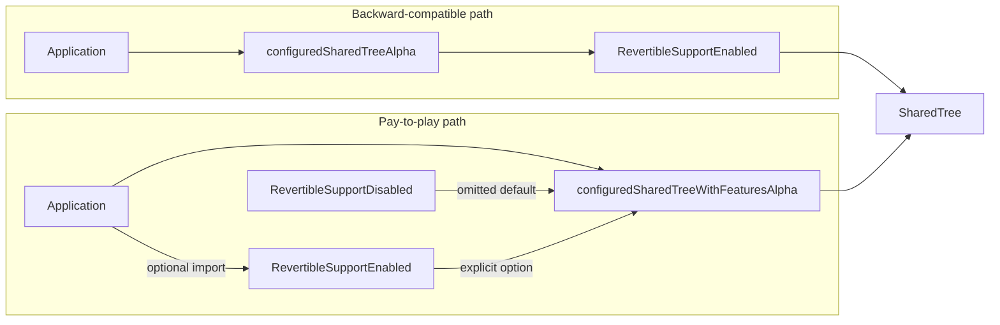
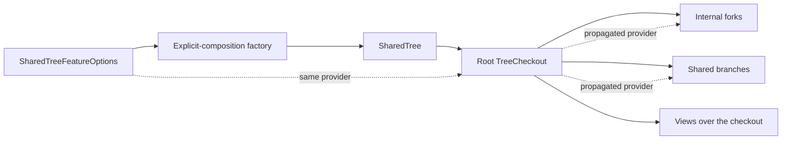
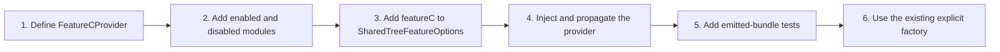
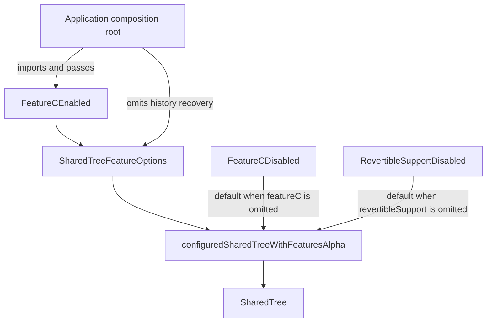

# SharedTree Tree-Shaking Architecture

## Goal

Some applications do not use every SharedTree feature.
Those applications should be able to exclude unused feature implementations from their bundles.

Runtime configuration alone does not guarantee tree-shaking.
If a factory imports the enabled implementation as its default, bundlers may include that implementation in the application bundle even when the application uses the disabled provider at runtime.

For example, the following factory always imports the enabled implementation:

```typescript
import { RevertibleSupportEnabled } from "./revertibleSupportEnabled.js";

function configuredSharedTreeAlpha(options: SharedTreeOptions) {
	const support = options.revertibleSupport ?? RevertibleSupportEnabled;
	return createSharedTree(support);
}
```

An application can select the disabled provider:

```typescript
configuredSharedTreeAlpha({
	revertibleSupport: RevertibleSupportDisabled,
});
```

`RevertibleSupportDisabled` avoids creating revertibles and retaining history at runtime.
However, the factory still imports `RevertibleSupportEnabled`, so a bundler can still include the enabled implementation.

SharedTree solves this problem with explicit provider injection:

- Existing factories preserve backward-compatible defaults.
- `configuredSharedTreeWithFeaturesAlpha` disables omitted optional features.
- The explicit factory imports lightweight disabled defaults, but no enabled implementations.
- The application imports and passes only the enabled implementations that it wants to include.

## What changed

The default factory continues to import and enable history recovery.
This preserves existing application behavior.

The explicit-composition factory imports the lightweight disabled history-recovery implementation.
Enabled history recovery becomes reachable only when the application imports and passes it.



Passing `RevertibleSupportDisabled` to `configuredSharedTreeAlpha` removes history-recovery state and processing at runtime.
It does not remove enabled history-recovery code from the bundle because that factory imports `RevertibleSupportEnabled`.

Use `configuredSharedTreeWithFeaturesAlpha` when application imports must control bundle contents.

## Application usage

Most applications do not need to change.
Existing factories continue to enable history recovery.

### Include history recovery

```typescript
import {
	configuredSharedTreeWithFeaturesAlpha,
	RevertibleSupportEnabled,
} from "@fluidframework/tree/alpha";

const SharedTree = configuredSharedTreeWithFeaturesAlpha({
	revertibleSupport: RevertibleSupportEnabled,
});
```

### Exclude history recovery

```typescript
import { configuredSharedTreeWithFeaturesAlpha } from "@fluidframework/tree/alpha";

const SharedTree = configuredSharedTreeWithFeaturesAlpha();
```

When history recovery is disabled:

- Normal editing, collaboration, transactions, branching, and rebasing continue to work.
- Changed events do not provide a revertible factory.
- Commit metadata does not provide its optional `revertTo` function.
- Explicit `revertTo` and `rewindTo` calls throw a `UsageError`.
- Enabled history-recovery code is not reachable through the explicit-composition path.

## Provider propagation

The selected provider must be used by every checkout created from the configured SharedTree.
An internal construction path must not restore the enabled default.



Independent-tree APIs select their provider separately and continue to default to enabled support.
Passing a disabled provider to those compatibility APIs removes runtime overhead but does not guarantee bundle exclusion.

## Adding a tree-shakable feature

### Architectural rule

Any new SharedTree runtime feature that must be independently tree-shakable must use provider injection.
Do not add a feature-specific factory or factories for combinations of features.

A feature needs a provider when:

- It adds runtime code that applications might want to exclude.
- It can expose enabled and disabled behavior through one contract.
- Its selected implementation must propagate through related checkouts.

An ordinary optional setting does not need a provider when all required implementation code is already part of the SharedTree core.

### Extension process

Adding feature C extends the provider options.
It does not add another factory.



Isolate the enabled implementation in a module that the explicit factory does not import:

```text
featureC.ts
featureCEnabled.ts
featureCDisabled.ts
```

The contract module must not import either concrete implementation.
The enabled module owns the feature state and algorithms.
The disabled implementation should be stateless when possible and must clearly handle unavailable
operations.
It may be imported by the explicit factory as the omitted-feature default, but it must not import
the enabled implementation.

Add one optional provider property:

```typescript
interface SharedTreeFeatureOptions extends SharedTreeOptions {
	readonly featureC?: FeatureCProvider;
	readonly revertibleSupport?: RevertibleSupport;
}
```

The factory selects the disabled provider when the option is omitted:

```typescript
const featureC = options.featureC ?? FeatureCDisabled;
```

The application passes only enabled features:

```typescript
const SharedTree = configuredSharedTreeWithFeaturesAlpha({
	featureC: FeatureCEnabled,
	// History recovery is omitted, so it remains disabled.
});
```



Only enabled choices require application imports.
Adding feature D adds one optional property and one disabled default, not new factories for the four
possible C and D combinations.

### Required checks

Before adding a provider, confirm:

1. The enabled implementation is isolated in a module that the explicit factory does not import.
2. The disabled implementation preserves core SharedTree behavior and does not import the enabled implementation.
3. `SharedTreeFeatureOptions` makes the provider optional, and omission selects the disabled implementation.
4. Existing compatibility factories select a backward-compatible default.
5. The provider propagates through root checkouts, forks, views, and branches.
6. Emitted-bundle tests prove that omitting the feature cannot reach the enabled module.

## History-recovery boundary

The first provider created with this pattern controls undo, redo, revertibles, and `revertTo`.

| Optional history-recovery implementation | SharedTree core |
| --- | --- |
| Revertible maps | Transaction rollback and change inversion |
| Retained branch snapshots | Branch forking and rebasing |
| Revertible creation and disposal | Detached-root tracking |
| Historical revision recovery | Commit-kind processing |
| Revertible event closures | Submitted changes and summaries |

Provider selection has no wire-format or summary-format effect.
Reverts continue to be submitted as ordinary changes.

## Bundle regression

The emitted-artifact tests in `examples/utils/bundle-size-tests` build enabled and disabled compositions.
They verify that the disabled composition cannot reach `revertibleSupportEnabled.js` and that excluding enabled history recovery produces a measurable bundle-size reduction.
