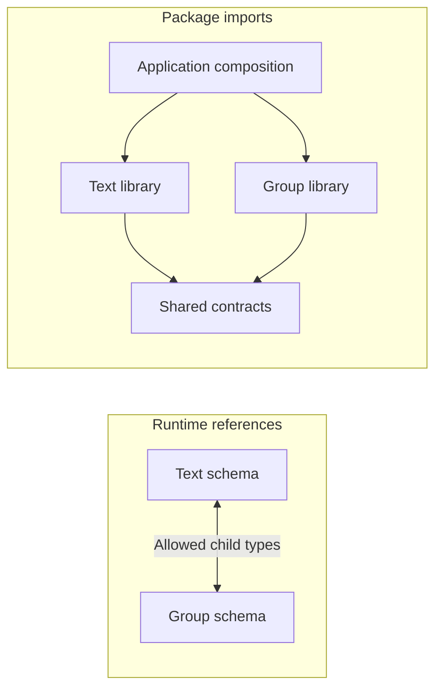

import { ApiLink } from "@site/src/components/shortLinks";

Prefer exporting one fixed schema configuration that all consumers can use.
Add configuration only when consumers need to choose child schemas or other parts of the persisted model.

## Fixed schemas as the default

Define schemas once and share the resulting classes, even if the library uses factories internally.
Ordinary content belongs in construction or editing: a text model does not need a different schema for each string.
The <ApiLink package="fluid-framework" api="PlainText" /> domain illustrates a fixed, encapsulated model.

## Minimal configuration boundaries

Keep generic factories limited to the schemas that depend on consumer choices; unrelated types and operations can remain fixed.
Pass options that affect only local behavior to ordinary operations or adapters instead of schema factories.
Resolve configuration at the layer that knows the choices: an application component can select child schemas once and expose a fixed model to its callers.

## Schema factory functions

Pass configuration explicitly rather than mutating a process-wide registry during imports.
Document:

-   Accepted child schema kinds, required behaviors, and supported option combinations.
-   Which inputs affect stored schema and how they determine identifiers.
-   How consumers construct nodes and whether they can subclass the result.

Preserve consumer-selected child types with utilities such as <ApiLink package="fluid-framework" api="TreeNodeFromImplicitAllowedTypes" /> and <ApiLink package="fluid-framework" api="InsertableTreeNodeFromImplicitAllowedTypes" />.
Existing nodes and insertable data are different contracts; do not replace them with plain objects or `any`.

Create each configuration once and share the result.
Repeated factory calls can produce distinct JavaScript classes with the same identifier, which cannot coexist in one view schema.
Configuration-dependent results must not share a single global cache.

### Avoiding Schema Identifier Collisions

For fixed schemas, use a library-owned <ApiLink package="fluid-framework" api="SchemaFactory.scope" />.
This assumes consumers do not need to combine distinct schema classes from multiple versions of the library in the same view schema.
For configurations that must coexist in a view, the consumer supplies distinct scopes, often through a factory created with <ApiLink package="fluid-framework" api="SchemaFactoryBeta.scopedFactory" />.
Choose these scopes once for the model and reuse them across clients and when reopening documents.
Two patterns are useful:

| Pattern             | Identifier construction                                               | Examples                                                                                                                                                                                                                                           |
| ------------------- | --------------------------------------------------------------------- | -------------------------------------------------------------------------------------------------------------------------------------------------------------------------------------------------------------------------------------------------- |
| Caller-owned scope  | The library supplies names within a scope reserved by the caller.     | <ApiLink package="fluid-framework" api="enumFromStrings" /> and <ApiLink package="fluid-framework" api="adaptEnum" /> use enum values as names.                                                                                                    |
| Library-owned scope | The library incorporates the supplied scope into its own identifiers. | <ApiLink package="fluid-framework" api="TableSchema" /> uses `com.fluidframework.tableV2<user-scope>.TableRoot`; <ApiLink package="fluid-framework" api="FormattedText.createSchema" /> uses `com.fluidframework.text.formatted<user-scope>.Text`. |

Give separate enums distinct scopes when values overlap.

Document how the supplied scope and schema names form each identifier, and keep that naming rule stable.
Distinct scopes prevent collisions, not incompatibility; matching identifiers do not prove configurations are interchangeable.
Handle configuration changes through [schema evolution](../schema-evolution/schema-libraries.mdx), not automatic package-version suffixes.

### Schema factory examples

Start with <ApiLink package="fluid-framework" api="SchemaFactory" /> itself: its methods return schemas configured by names, fields, and allowed types.
For smaller schema-creation utilities, see <ApiLink package="fluid-framework" api="enumFromStrings" /> and <ApiLink package="fluid-framework" api="adaptEnum" />, which derive schemas from focused inputs without a component system.

For a reusable model, consider a box that can hold caller-selected content.
An application needs one box for notes or strings and another for a numeric quantity.
This example extends the [encapsulated root pattern](./encapsulation-and-exports.mdx#explicit-public-types): the new concerns are preserving the selected child types and giving each configuration a stable identity.
The [configurable library walkthrough](https://github.com/microsoft/FluidFramework/blob/main/packages/dds/tree/src/test/configurableSchemaLibrary.integration.ts) provides the complete source, imports, and tests.
The erasure APIs come from `@fluidframework/tree/alpha`, and `createIndependentTreeView` comes from `@fluidframework/tree/beta`.
The other APIs come from `@fluidframework/tree`.

#### Preserve the selected child types

The library exposes a readable `value` and a static `create` method.
The readable value uses the selected node types; the factory accepts insertable content, including plain objects where the child schema permits them.
The `Box` type also retains the caller's scope as part of its identifier:

{/* markdown-magic:begin {"transform":"include-code","path":"../../../../../packages/dds/tree/src/test/configurableSchemaLibrary.integration.ts","language":"typescript","start":37,"end":61} */}
{/* prettier-ignore-start */}
{/* NOTE: This section is automatically generated using @fluid-tools/markdown-magic. Do not update these generated contents directly. */}

```typescript
/**
 * A box whose persisted identity includes the caller's scope.
 */
export type Box<Scope extends string, Allowed extends ImplicitAllowedTypes> = ErasedNode<
	{ readonly value: TreeNodeFromImplicitAllowedTypes<Allowed> },
	`com.example.box<${Scope}>.Box`
>;

/**
 * Construction without exposing stored fields.
 */
export interface BoxStatics<Scope extends string, Allowed extends ImplicitAllowedTypes> {
	/** Accepts plain objects for child schemas that support them, not just existing nodes. */
	create(value: InsertableTreeNodeFromImplicitAllowedTypes<Allowed>): Box<Scope, Allowed>;
}

/**
 * The public schema and construction contract.
 */
export type BoxSchema<Scope extends string, Allowed extends ImplicitAllowedTypes> = BoxStatics<
	Scope,
	Allowed
> &
	ErasedSchema<Box<Scope, Allowed>>;
```

{/* prettier-ignore-end */}
{/* markdown-magic:end */}

#### Implement the factory

The factory stores the selected content in a required field, but its explicit `BoxSchema` return type hides that field from consumers.
The identifier encloses the caller's scope in angle brackets, keeping it separate from the library-owned `Box` type name.
This follows the library-owned scope convention used by `TableSchema` and `FormattedText`:

{/* markdown-magic:begin {"transform":"include-code","path":"../../../../../packages/dds/tree/src/test/configurableSchemaLibrary.integration.ts","language":"typescript","start":66,"end":93} */}
{/* prettier-ignore-start */}
{/* NOTE: This section is automatically generated using @fluid-tools/markdown-magic. Do not update these generated contents directly. */}

```typescript
/**
 * Creates one configured box schema with identifier `com.example.box<scope>.Box`.
 * Reuse the result and keep the scope stable; configurations that coexist need distinct scopes.
 */
export function createBoxSchema<Scope extends string, Allowed extends ImplicitAllowedTypes>(
	scope: Scope,
	allowed: Allowed,
): BoxSchema<Scope, Allowed> {
	const boxFactory = new SchemaFactory("com.example");
	class BoxImplementation extends boxFactory.object(`box<${scope}>.Box`, {
		content: boxFactory.required(allowed),
	}) {
		public get value(): TreeNodeFromImplicitAllowedTypes<Allowed> {
			return this.content;
		}

		public static create(
			value: InsertableTreeNodeFromImplicitAllowedTypes<Allowed>,
		): BoxImplementation {
			return new BoxImplementation({ content: value });
		}
	}

	return eraseSchemaDetails<Box<Scope, Allowed>, BoxStatics<Scope, Allowed>>()(
		BoxImplementation,
	);
}
```

{/* prettier-ignore-end */}
{/* markdown-magic:end */}

#### Configure once at the application boundary

The application defines its `Note` type and creates two box schemas with distinct scopes.
The readonly tuple preserves the choice between a `Note` node and a string.
Both box schemas can then coexist in one root:

{/* markdown-magic:begin {"transform":"include-code","path":"../../../../../packages/dds/tree/src/test/configurableSchemaLibrary.integration.ts","language":"typescript","start":98,"end":109} */}
{/* prettier-ignore-start */}
{/* NOTE: This section is automatically generated using @fluid-tools/markdown-magic. Do not update these generated contents directly. */}

```typescript
const applicationFactory = new SchemaFactory("com.example.boxes.app");
class Note extends applicationFactory.object("Note", {
	text: applicationFactory.string,
}) {}

const NotesBox = createBoxSchema("notes", [Note, applicationFactory.string] as const);
const QuantityBox = createBoxSchema("quantity", applicationFactory.number);
class Root extends applicationFactory.object("Root", {
	notes: NotesBox,
	quantity: QuantityBox,
}) {}
```

{/* prettier-ignore-end */}
{/* markdown-magic:end */}

#### Construct content through the configured schemas

Reuse those schema classes when creating views.
`NotesBox.create` accepts an insertable note object; `QuantityBox.create` accepts a number:

{/* markdown-magic:begin {"transform":"include-code","path":"../../../../../packages/dds/tree/src/test/configurableSchemaLibrary.integration.ts","language":"typescript","start":110,"end":118} */}
{/* prettier-ignore-start */}
{/* NOTE: This section is automatically generated using @fluid-tools/markdown-magic. Do not update these generated contents directly. */}

```typescript
function createBoxesView() {
	const view = createIndependentTreeView(new TreeViewConfiguration({ schema: Root }));
	view.initialize({
		notes: NotesBox.create({ text: "Remember this" }),
		quantity: QuantityBox.create(3),
	});
	return view;
}
```

{/* prettier-ignore-end */}
{/* markdown-magic:end */}

After calling `createBoxesView()`, `view.root.notes.value` is a `Note` or a string, while `view.root.quantity.value` is a number.
Use `Tree.is(value, Note)` to narrow the note value before editing its `text`.
Passing a string to `QuantityBox.create` is a type error; the walkthrough also tests its runtime rejection.
The box identifiers remain `com.example.box<notes>.Box` and `com.example.box<quantity>.Box` across views.

These examples use `createIndependentTreeView` to exercise the model without a Fluid service.
For application view creation, follow the [initialization flow](../recommended-init-flow.mdx).

For larger examples, see <ApiLink package="fluid-framework" api="FormattedText.createSchema" /> for formatting and extra atom schemas, or <ApiLink package="fluid-framework" api="TableSchema" /> for separately configurable cells, rows, and columns.
Use their public contracts and release tags, not internal helpers, as extension points.

## Versioning configurable libraries

Test concrete configurations, not just factory signatures; see [Testing Schema Libraries](../schema-evolution/testing-schema-upgrades.mdx#testing-schema-libraries).
To support independently deployed applications at different rollout stages, a library can offer:

-   Separate factories for supported model variants.
-   Feature flags selecting schema changes or new writes.
-   A compatibility threshold: the oldest schema-library version with which the configured model must collaborate, used to select compatible features.

<ApiLink
	package="container-runtime"
	api="LoadContainerRuntimeParams.oldestSupportedClient"
/> illustrates the threshold pattern, but a schema library should use its own versions, not Fluid
Framework versions. Document the supported features for each setting; these are explicit application
choices, not automatic client-version detection. Dependency updates alone should not enable
incompatible writes. These controls supplement [schema rollout and compatibility
policies](../schema-evolution/schema-libraries.mdx).

## Composition of independently authored schemas

Let the application select contributions and aggregate their allowed types.
Ordinary factory calls are enough when dependencies do not refer back to each other; an existing component system can also do this work.

Put shared instance and static contracts in a module that does not import their implementations.
Libraries implement those contracts; application composition imports the libraries, avoiding a container library that depends on every item it can hold.

The resulting allowed-type set is fixed: installing a plugin does not permit mutating an existing allowed-types array.
Changes for existing documents need a [schema rollout](../schema-evolution/index.mdx).

## Mutually recursive libraries

Use the alpha <ApiLink package="fluid-framework" api="Component" /> utilities when independently authored schemas need references to a final composition that may refer back to them.
The [walkthrough below](#runnable-composition-examples) shows groups containing text items whose attachments can contain groups.



Import arrows point from a consumer to its dependency; schema-reference arrows show allowed child types.
Shared contracts avoid imports between implementation packages, while laziness defers schema evaluation until contributions are available.
For TypeScript recursion, use explicit named contracts and APIs such as <ApiLink package="fluid-framework" api="SchemaFactory.objectRecursive" />.
Laziness does not resolve circular inference or [declaration-emission constraints](./encapsulation-and-exports.mdx#package-export-boundaries).

### Component composition lifecycle

Define schema references with <ApiLink package="fluid-framework" api="Component.LazyArray" /> and capture the lazy configuration in <ApiLink package="fluid-framework" api="Component.Factory" /> functions.
Call <ApiLink package="fluid-framework" api="Component.(compose:1)" /> before retrieving contributions with <ApiLink package="fluid-framework" api="Component.Composed.getComposed" /> or component-specific exports with <ApiLink package="fluid-framework" api="Component.Composed.getComponent" />.

View configuration and node construction can force schema evaluation.
Construct the root schema and <ApiLink package="fluid-framework" api="TreeViewConfiguration" /> only after composition, never inside component factories.

If multiple paths expose a schema, such as a contribution and a component-specific export, they must return the same class.
Create a <ApiLink package="fluid-framework" api="Component.memoize" /> callback inside the component factory so its cache belongs to that composition.
For other cached, configuration-dependent results, see <ApiLink package="fluid-framework" api="Component.Configurable" /> and <ApiLink package="fluid-framework" api="Component.Composed.getConfigured" />.

The [text and group libraries below](#runnable-composition-examples) apply this lifecycle.

## Types at composition boundaries

Keep precise schema types when known; otherwise expose the shared operations and construction contract.
Implementing a TypeScript interface does not establish membership in the runtime allowed-type set.

Broad collections can reduce insertable types to `never`; see the [typing FAQ](https://github.com/microsoft/FluidFramework/blob/main/packages/dds/tree/README.md#why-is-my-insertable-content-getting-typed-as-never).
Keep unavoidable casts at a typed model-owned insertion boundary, retain runtime checks, and test registered and unregistered types.
`satisfies` preserves specific inferred exports, but does not replace annotations required by isolated declaration emission.

## Runnable composition examples

The [component walkthrough](https://github.com/microsoft/FluidFramework/blob/main/packages/dds/tree/src/test/components.integration.ts) models a document editor with text items and groups and includes all imports and tests.
Text items can attach groups, and groups can contain text items or more groups.
The following steps show the contracts, each library, and the application that connects them.
Import `Component` from `@fluidframework/tree/alpha` and `createIndependentTreeView` from `@fluidframework/tree/beta`.
Import the other APIs from `@fluidframework/tree`.

### Define shared item contracts

Every item supplies a `describe` operation.
Each contributed schema also supplies a menu label and a `create` factory.
`ItemComponent` collects those schemas lazily so libraries can refer to the final set before any schema is evaluated:

{/* markdown-magic:begin {"transform":"include-code","path":"../../../../../packages/dds/tree/src/test/components.integration.ts","language":"typescript","start":36,"end":55} */}
{/* prettier-ignore-start */}
{/* NOTE: This section is automatically generated using @fluid-tools/markdown-magic. Do not update these generated contents directly. */}

```typescript
/**
 * Operations shared by all contributed items.
 */
export type Item = TreeNode & { describe(): string };

/**
 * A contributed schema with a creation-menu label and factory.
 */
export type ItemSchema = TreeNodeSchema<string, NodeKind.Object, Item> & {
	readonly description: string;
	create(): Item;
};

/**
 * Lazy references to the schemas contributed by an item library.
 */
export interface ItemComponent {
	readonly items: Component.LazyArray<ItemSchema>;
}
```

{/* prettier-ignore-end */}
{/* markdown-magic:end */}

In separate packages, put these contracts in a module that neither imports nor selects the implementations.

### Contribute text items

The text library gets its allowed attachment types from the composition, not by importing the group library.
Put schema creation inside `Component.memoize`: the factory returns a callback without evaluating `lazyComposition()`.
After composition, the first call creates the schema; later calls return the same class.
Both the `items` contribution and the `textSchema` export use that callback:

{/* markdown-magic:begin {"transform":"include-code","path":"../../../../../packages/dds/tree/src/test/components.integration.ts","language":"typescript","start":60,"end":86} */}
{/* prettier-ignore-start */}
{/* NOTE: This section is automatically generated using @fluid-tools/markdown-magic. Do not update these generated contents directly. */}

```typescript
const textComponent = ((lazyComposition) => {
	const textSchema = Component.memoize(() => {
		const factory = new SchemaFactory("com.example.components.text");
		class TextItem extends factory.object("Text", {
			text: factory.string,
			attachment: factory.optional(lazyComposition().getComposed("items")),
		}) {
			public static readonly description = "Text";

			public static create(): TextItem {
				return new TextItem({ text: "New text" });
			}

			public describe(): string {
				return this.text;
			}

			public attach(item: Item): void {
				// The open insertion boundary retains runtime schema checks.
				this.attachment = item as never;
			}
		}
		return TextItem;
	});
	return { items: () => [textSchema], textSchema };
}) satisfies Component.Factory<ItemComponent>;
```

{/* prettier-ignore-end */}
{/* markdown-magic:end */}

### Contribute groups

The group library follows the same pattern.
Its children use the composed item schemas, so a group can contain another group without evaluating the recursive references during composition:

{/* markdown-magic:begin {"transform":"include-code","path":"../../../../../packages/dds/tree/src/test/components.integration.ts","language":"typescript","start":91,"end":116} */}
{/* prettier-ignore-start */}
{/* NOTE: This section is automatically generated using @fluid-tools/markdown-magic. Do not update these generated contents directly. */}

```typescript
const groupComponent = ((lazyComposition) => {
	const groupSchema = Component.memoize(() => {
		const factory = new SchemaFactory("com.example.components.group");
		class Children extends factory.array("Children", lazyComposition().getComposed("items")) {}

		class Group extends factory.object("Group", { children: Children }) {
			public static readonly description = "Group";

			public static create(): Group {
				return new Group({ children: [] });
			}

			public describe(): string {
				return this.children.map((child) => child.describe()).join(", ");
			}

			public add(item: Item): void {
				// The open insertion boundary retains runtime schema checks.
				this.children.insertAtEnd(item as never);
			}
		}
		return Group;
	});
	return { items: () => [groupSchema], groupSchema };
}) satisfies Component.Factory<ItemComponent>;
```

{/* prettier-ignore-end */}
{/* markdown-magic:end */}

The `attach` and `add` methods contain the casts needed at the [open insertion boundary](#types-at-composition-boundaries).
They do not bypass runtime schema checks: an item must still belong to the composition's allowed types.
These libraries use fixed identifiers; configure a more general library with [distinct scopes](#avoiding-schema-identifier-collisions) when multiple configurations must coexist in one view.

### Compose and use the application model

Select the libraries and compose them once.
Only after composition, retrieve their schema classes and define the application root:

{/* markdown-magic:begin {"transform":"include-code","path":"../../../../../packages/dds/tree/src/test/components.integration.ts","language":"typescript","start":121,"end":126} */}
{/* prettier-ignore-start */}
{/* NOTE: This section is automatically generated using @fluid-tools/markdown-magic. Do not update these generated contents directly. */}

```typescript
const editorComposition = Component.compose([groupComponent, textComponent]);
const EditorGroup = editorComposition.getComponent(groupComponent).groupSchema();
const EditorTextItem = editorComposition.getComponent(textComponent).textSchema();
const applicationFactory = new SchemaFactory("com.example.components.app");
class Root extends applicationFactory.object("Root", { group: EditorGroup }) {}
```

{/* prettier-ignore-end */}
{/* markdown-magic:end */}

Reuse that root for each document.
This function initializes a group, adds a nested group containing text, and gives that text an attached group:

{/* markdown-magic:begin {"transform":"include-code","path":"../../../../../packages/dds/tree/src/test/components.integration.ts","language":"typescript","start":127,"end":137} */}
{/* prettier-ignore-start */}
{/* NOTE: This section is automatically generated using @fluid-tools/markdown-magic. Do not update these generated contents directly. */}

```typescript
function createEditorView() {
	const view = createIndependentTreeView(new TreeViewConfiguration({ schema: Root }));
	view.initialize({ group: EditorGroup.create() });
	const nestedGroup = EditorGroup.create();
	const text = EditorTextItem.create();
	text.attach(EditorGroup.create());
	nestedGroup.add(text);
	view.root.group.add(nestedGroup);
	return view;
}
```

{/* prettier-ignore-end */}
{/* markdown-magic:end */}

After calling `createEditorView()`, `view.root.group.describe()` returns `"New text"`.
The application can also build a creation menu from `editorComposition.getComposed("items")`; each schema supplies its own label and factory.

The walkthrough tests these operations, schema reuse, independent document state and compositions, unregistered types, and consumers that know only the shared contract.
The [open-polymorphism tests](https://github.com/microsoft/FluidFramework/blob/main/packages/dds/tree/src/test/openPolymorphism.integration.ts) retain alternatives and edge cases; their skipped mutable-registry examples are unsupported.
Run these examples with the [tree package development workflow](https://github.com/microsoft/FluidFramework/blob/main/packages/dds/tree/README.md#recommended-developer-workflow).
