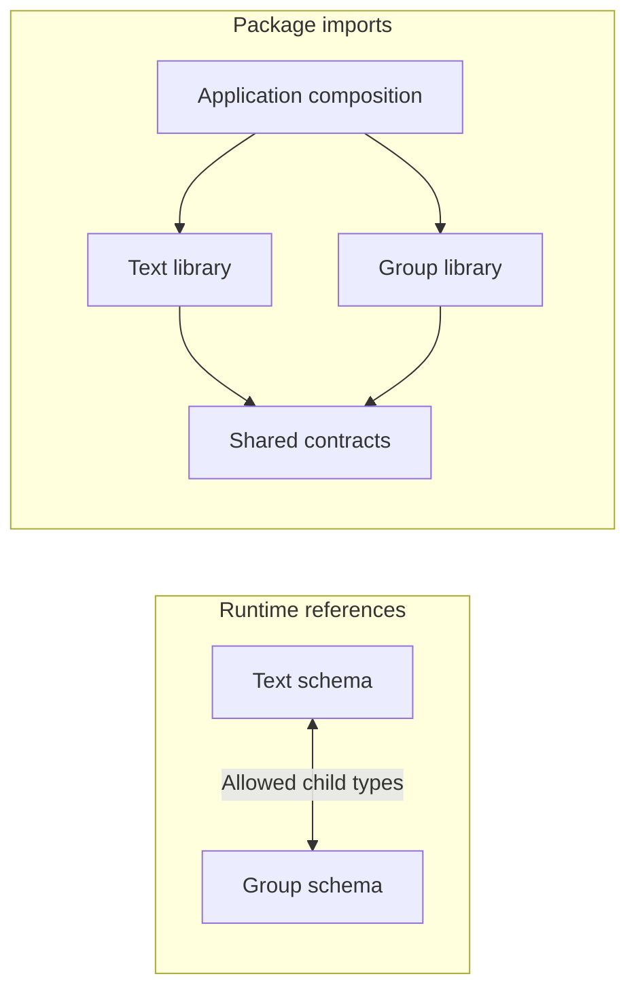
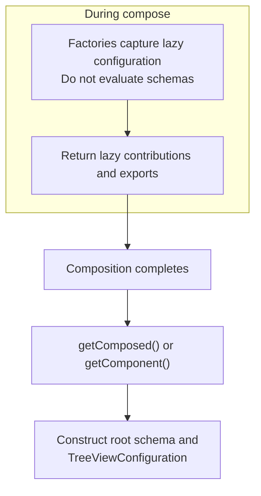

import { ApiLink } from "@site/src/components/shortLinks";

Prefer exporting one fixed schema configuration that all consumers can use.
Add configuration only when consumers need to choose child schemas or other parts of the persisted model.

## Fixed schemas as the default

Define schemas once and share the resulting classes, even if the library uses factories internally.
Ordinary content belongs in construction or editing: a text model does not need a different schema for each string.
The <ApiLink package="fluid-framework" api="PlainText" /> domain illustrates a fixed, encapsulated model.

## Minimal configuration boundaries

Keep generic factories limited to the schemas that depend on consumer choices; unrelated types and operations can remain fixed.
Pass options that affect only local behavior to ordinary operations or adapters instead of schema factories.
Resolve configuration at the layer that knows the choices: an application component can select child schemas once and expose a fixed model to its callers.

## Schema factory functions

Pass configuration explicitly rather than mutating a process-wide registry during imports.
Document:

-   Accepted child schema kinds, required behaviors, and supported option combinations.
-   Which inputs affect stored schema and how they determine identifiers.
-   How consumers construct nodes and whether they can subclass the result.

Preserve consumer-selected child types with utilities such as <ApiLink package="fluid-framework" api="TreeNodeFromImplicitAllowedTypes" /> and <ApiLink package="fluid-framework" api="InsertableTreeNodeFromImplicitAllowedTypes" />.
Existing nodes and insertable data are different contracts; do not replace them with plain objects or `any`.

Create each configuration once and share the result.
Repeated factory calls can produce distinct JavaScript classes with the same identifier, which cannot coexist in one view schema.
Configuration-dependent results must not share a single global cache.

### Avoiding Schema Identifier Collisions

For fixed schemas, use a library-owned <ApiLink package="fluid-framework" api="SchemaFactory.scope" />.
This assumes consumers do not need to combine distinct schema classes from multiple versions of the library in the same view schema.
For configurations that must coexist in a view, the consumer supplies distinct scopes, often through a factory created with <ApiLink package="fluid-framework" api="SchemaFactoryBeta.scopedFactory" />.
Choose these scopes once for the model and reuse them across clients and when reopening documents.
Two patterns are useful:

| Pattern             | Identifier construction                                               | Examples                                                                                                                                                                                                                                     |
| ------------------- | --------------------------------------------------------------------- | -------------------------------------------------------------------------------------------------------------------------------------------------------------------------------------------------------------------------------------------- |
| Caller-owned scope  | The library supplies names within a scope reserved by the caller.     | <ApiLink package="fluid-framework" api="enumFromStrings" /> and <ApiLink package="fluid-framework" api="adaptEnum" /> use enum values as names.                                                                                              |
| Library-owned scope | The library incorporates the supplied scope into its own identifiers. | <ApiLink package="fluid-framework" api="TableSchema" /> uses `com.fluidframework.table<user-scope>.Table`; <ApiLink package="fluid-framework" api="FormattedText.createSchema" /> uses `com.fluidframework.text.formatted<user-scope>.Text`. |

Give separate enums distinct scopes when values overlap.

Document how the supplied scope and schema names form each identifier, and keep that naming rule stable.
Distinct scopes prevent collisions, not incompatibility; matching identifiers do not prove configurations are interchangeable.
Handle configuration changes through [schema evolution](../schema-evolution/schema-libraries.mdx), not automatic package-version suffixes.

### Schema factory examples

Start with <ApiLink package="fluid-framework" api="SchemaFactory" /> itself: its methods return schemas configured by names, fields, and allowed types.
For smaller schema-creation utilities, see <ApiLink package="fluid-framework" api="enumFromStrings" /> and <ApiLink package="fluid-framework" api="adaptEnum" />, which derive schemas from focused inputs without a component system.

Then see the executable [configurable library walkthrough](https://github.com/microsoft/FluidFramework/blob/main/packages/dds/tree/src/test/configurableSchemaLibrary.integration.ts): an explicitly typed factory and two scoped configurations embedded in one root.
For larger examples, see <ApiLink package="fluid-framework" api="FormattedText.createSchema" /> for formatting and extra atom schemas, or <ApiLink package="fluid-framework" api="TableSchema" /> for separately configurable cells, rows, and columns.
Use their public contracts and release tags, not internal helpers, as extension points.

## Versioning configurable libraries

Test concrete configurations, not just factory signatures; see [Testing Schema Libraries](../schema-evolution/testing-schema-upgrades.mdx#testing-schema-libraries).
To support independently deployed applications at different rollout stages, a library can offer:

-   Separate factories for supported model variants.
-   Feature flags selecting schema changes or new writes.
-   A compatibility threshold: the oldest schema-library version with which the configured model must collaborate, used to select compatible features.

<ApiLink
	package="container-runtime"
	api="LoadContainerRuntimeParams.oldestSupportedClient"
/> illustrates the threshold pattern, but a schema library should use its own versions, not Fluid
Framework versions. Document the supported features for each setting; these are explicit application
choices, not automatic client-version detection. Dependency updates alone should not enable
incompatible writes. These controls supplement [schema rollout and compatibility
policies](../schema-evolution/schema-libraries.mdx).

## Composition of independently authored schemas

Let the application select contributions and aggregate their allowed types.
Ordinary factory calls are enough when dependencies do not refer back to each other; an existing component system can also do this work.

Put shared instance and static contracts in a module that does not import their implementations.
Libraries implement those contracts; application composition imports the libraries, avoiding a container library that depends on every item it can hold.

The resulting allowed-type set is fixed: installing a plugin does not permit mutating an existing allowed-types array.
Changes for existing documents need a [schema rollout](../schema-evolution/index.mdx).

## Mutually recursive libraries

Use the alpha <ApiLink package="fluid-framework" api="Component" /> utilities when independently authored schemas need references to a final composition that may refer back to them.
The [walkthrough below](#runnable-composition-examples) shows groups containing text items whose attachments can contain groups.

Import arrows point from a consumer to its dependency; schema-reference arrows show allowed child types.
Shared contracts avoid imports between implementation packages, while laziness defers schema evaluation until contributions are available.
For TypeScript recursion, use explicit named contracts and APIs such as <ApiLink package="fluid-framework" api="SchemaFactory.objectRecursive" />.
Laziness does not resolve circular inference or [declaration-emission constraints](./encapsulation-and-exports.mdx#package-export-boundaries).

### Component composition lifecycle

Define schema references with <ApiLink package="fluid-framework" api="Component.LazyArray" /> and capture the lazy configuration in <ApiLink package="fluid-framework" api="Component.Factory" /> functions.
Call <ApiLink package="fluid-framework" api="Component.(compose:1)" /> before retrieving contributions with <ApiLink package="fluid-framework" api="Component.Composed.getComposed" /> or component-specific exports with <ApiLink package="fluid-framework" api="Component.Composed.getComponent" />.

View configuration and node construction can force schema evaluation.
Construct the root schema and <ApiLink package="fluid-framework" api="TreeViewConfiguration" /> only after composition, never inside component factories.

If multiple paths expose a schema, such as a contribution and a component-specific export, they must return the same class.
Create a <ApiLink package="fluid-framework" api="Component.memoize" /> callback inside the component factory so its cache belongs to that composition.
For other cached, configuration-dependent results, see <ApiLink package="fluid-framework" api="Component.Configurable" /> and <ApiLink package="fluid-framework" api="Component.Composed.getConfigured" />.

## Types at composition boundaries

Keep precise schema types when known; otherwise expose the shared operations and construction contract.
Implementing a TypeScript interface does not establish membership in the runtime allowed-type set.

Broad collections can reduce insertable types to `never`; see the [typing FAQ](https://github.com/microsoft/FluidFramework/blob/main/packages/dds/tree/README.md#why-is-my-insertable-content-getting-typed-as-never).
Keep unavoidable casts at a typed model-owned insertion boundary, retain runtime checks, and test registered and unregistered types.
`satisfies` preserves specific inferred exports, but does not replace annotations required by isolated declaration emission.

## Runnable composition examples

Read the [component walkthrough](https://github.com/microsoft/FluidFramework/blob/main/packages/dds/tree/src/test/components.integration.ts) from shared contracts through the two libraries to application consumers.
It tests recursion, schema reuse, independent compositions, unregistered types, and consumers that know only the shared contract.
The [open-polymorphism tests](https://github.com/microsoft/FluidFramework/blob/main/packages/dds/tree/src/test/openPolymorphism.integration.ts) retain alternatives and edge cases; their skipped mutable-registry examples are unsupported.
Run these examples with the [tree package development workflow](https://github.com/microsoft/FluidFramework/blob/main/packages/dds/tree/README.md#recommended-developer-workflow).
